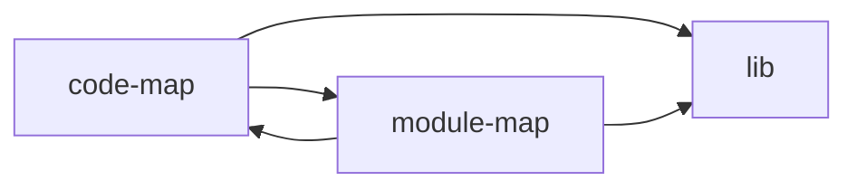

# code-indexer System Architecture

Generated from `docs/code-index/module-map.json` at 2026-06-30T13:24:53.517Z. Regenerate with `/ci arch`.

## Use This When

- Use for repo onboarding, cross-module architecture review, and human handoff.
- For routine implementation planning, start with `docs/code-index/index.md` and the minimum relevant module files.

## System Overview

<!-- code-index:system-overview:start -->
code-indexer is a plugin-hosted generator split into three module families. `code-map` scans source with ast-grep and endpoint extractors to produce the symbol and endpoint index. `module-map` consumes that index plus repository structure to discover modules, derive dependency edges, render planning docs, run doctor checks, and bootstrap target repos. `lib` holds shared runtime utilities such as plugin-root resolution, ast-grep resolution, skip-directory policy, and scan parsing.

The dependency graph is intentionally small: both generator modules depend on `lib`, and `code-map` and `module-map` reference each other through the generation pipeline. Routine implementation planning should still start from the scoped module docs; this system view is for onboarding, architecture review, and handoff.
<!-- code-index:system-overview:end -->

## Component Diagram

## Module Responsibilities

| Module | Owns | Depends on | Used by | Module file |
|--------|------|------------|---------|-------------|
| code-map | ast-grep-based symbol and endpoint indexer that feeds the module graph. | lib, module-map | module-map | `docs/code-index/modules/code-map.md` |
| lib | Shared utilities for both generators: plugin-root resolution, ast-grep resolution, skip-dirs, scan parsing. | - | code-map, module-map | `docs/code-index/modules/lib.md` |
| module-map | Module-graph generator: module discovery, enrichment, rendering, doctor, and bootstrap. | code-map, lib | code-map | `docs/code-index/modules/module-map.md` |

## Dependency Flows

- `code-map` -> `lib`
- `code-map` -> `module-map`
- `module-map` -> `code-map`
- `module-map` -> `lib`

<!-- code-index:system-architecture generated 2026-06-30T13:24:53.517Z -->
