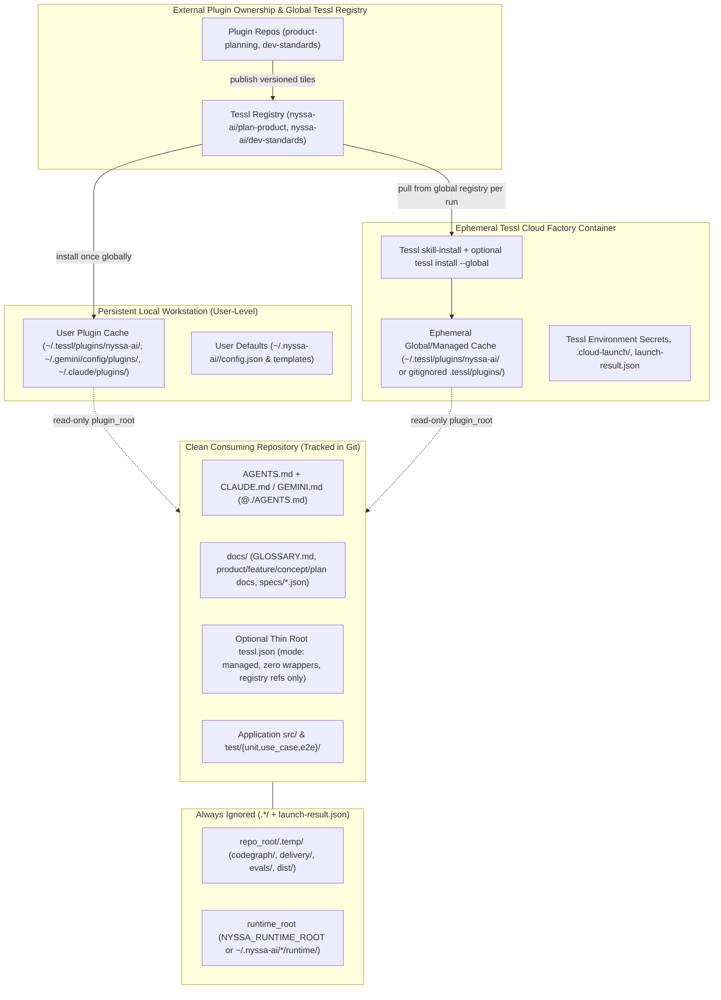

# C-04: External Plugin Isolation & Ephemeral Factory Boundaries

## Summary

Consuming repositories remain as clean as possible across both persistent local workstations and ephemeral cloud factories (such as Tessl Cloud). Both `nyssa-ai/plan-product` and `nyssa-ai/dev-standards` are published to the external Tessl Registry and installed at the user/global level (`~/.tessl/plugins/nyssa-ai/`, `~/.gemini/config/plugins/`, `~/.claude/plugins/`) or materialized ephemerally at cloud container boot—never copied, vendored, or wrapped inside application repositories. Default consuming repositories contain zero `.nyssa-ai/` config directories, zero wrapper skills, and zero `.tessl/plugins/` caches, retaining only `AGENTS.md` (with host delegates), `docs/`, application `src/` + `test/`, `.gitignore` (`.*/`), and—when using repo-bound Tessl triggers—a single thin root `tessl.json` referencing the global registry plugins directly.

## Core Model / Stages

Keeping plugin code and configuration out of consuming repositories separates four concerns:

1. **External Registry & Plugin Code (`plugin_root`)**: Skills, workflows, subagents, rulebooks, templates, and runtime/checker scripts live exclusively in `plan-product` and `dev-standards`, published to the Tessl Registry (`nyssa-ai/plan-product`, `nyssa-ai/dev-standards`) and materialized into user-global caches locally (`~/.tessl/plugins/nyssa-ai/`, `~/.gemini/config/plugins/`, `~/.claude/plugins/`) or ephemeral caches in cloud containers (`~/.tessl/plugins/nyssa-ai/` or gitignored `.tessl/plugins/nyssa-ai/`).
2. **Clean Consuming Repository (`repo_root`)**: Tracks only project-owned files: `AGENTS.md` (+ `@./AGENTS.md` delegates), `docs/` (canonical Model v2 layout discovered automatically at `docs/` or `<unit>/docs/`), application `src/` + `test/`, `.gitignore` (`.*/`), and an optional thin root `tessl.json` (`"mode": "managed"`) wiring actions directly to `"nyssa-ai/dev-standards#dev-delivery"` and declaring `"nyssa-ai/plan-product"` from the Tessl Registry—with zero `.nyssa-ai/` files and zero `file:` wrapper directories by default.
3. **User Defaults & Secrets (`user_home` / Secret Stores)**: Personal cross-repo defaults (`~/.nyssa-ai/plan-product/`, `~/.nyssa-ai/config-manifest.json`) and credentials (Tessl Environments, `vps-secrets`, `NyssaAI.Configuration`) live outside `repo_root` and are never committed.
4. **Mutable Execution State & Scratch (`runtime_root` & `<repo_root>/.temp/`)**: Ephemeral runtime artifacts—CodeGraph indexes (`.temp/codegraph/`), TDD firewall snapshots, opt-in `usage/events.jsonl`, `.cloud-launch/`, and clone-root `launch-result.json`—remain untracked and gitignored.



### Leakage Anti-Patterns Prevented

| Anti-Pattern | Failure Mode | Zero-Footprint Prevention |
| :--- | :--- | :--- |
| **1. Vendored Standards & Copied Templates** | Committing `.nyssa-ai/dev-standards/`, stock `.nyssa-ai/plan-product/config.json`, or copied starter templates into consuming repos. | Bloats repos, leaks internal methodology, and drifts behind registry upgrades. Both plugins resolve defaults and templates directly from `plugin_root` -> `user_home`. |
| **2. In-Repo Wrapper Plugins (`file:tessl-factory`)** | Embedding wrapper skills and schemas inside consuming repos via `"source": "file:..."` in `tessl.json`. | Leaks private prompts into public/app repos and duplicates workflow logic. Zero-wrapper `tessl.json` actions invoke `"nyssa-ai/dev-standards#dev-delivery"` directly with static `inputs.STAGE`, `params`, and `overlays`. |
| **3. Installer Working-Tree Pollution** | Project-local `tessl install` injecting `# Agent Rules <!-- tessl-managed -->` (`@.tessl/RULES.md`) into `AGENTS.md`, `CLAUDE.md`, or `GEMINI.md`. | Risks committing Tessl-injected lines into tracked governance files and breaking `@./AGENTS.md` parity. Prefer global installs (`tessl install --global`) and stage explicit owned paths only. |
| **4. Tile Packaging Stripping `src/`** | `.tessl-plugin/plugin.json` packages `"skills": "./skills"`, stripping top-level `src/` and `test/`. | Mirror self-contained runtime scripts under `skills/<skill>/scripts/` (`SKILL_RUNTIME_MIRRORS` in `product-planning`, `SKILL_CHECKER_MIRRORS` + JSON bundles in `dev-standards`). |
| **5. Unignored Clone-Root `launch-result.json`** | `.*/` ignores dot-directories only and does not ignore regular files like `launch-result.json`. | Always ignore `launch-result.json` explicitly in `.gitignore` and ban staging it in factory workflows. |

### Ownership Matrix: Consumer `repo_root` Boundaries

| Artifact Class | Belongs in Consumer `repo_root`? | Canonical Location | Rationale |
| :--- | :--- | :--- | :--- |
| Plugin skills (`SKILL.md`, `workflows/`, `sub-agents/`), rules, templates | **NO** | Tessl Registry (`nyssa-ai/plan-product`, `nyssa-ai/dev-standards`) -> user/ephemeral `plugin_root` | Single source of truth; zero proprietary leakage or diff bloat. |
| Plugin checkers, scripts & factory wrappers (`src/`, `scripts/`, `tessl-factory/`) | **NO** | External `plugin_root` (mirrored under `skills/*/scripts/` for registry tiles) | Upgrades cleanly via registry version pin. |
| Materialized plugin caches (`.tessl/plugins/`, `.tessl/tiles/`, `.agents/`, `.hermes/`, `.claude/`) | **NO (Never tracked)** | User-global cache (`~/.tessl/plugins/`, `~/.gemini/...`) or gitignored `.tessl/plugins/` | Runtime materialization artifact, never authored repo source. |
| `AGENTS.md`, `CLAUDE.md`, `GEMINI.md`, `HERMES.md` | **YES (Thin Anchor)** | `repo_root/AGENTS.md` + `@./AGENTS.md` delegates | Stores project instructions + `<!-- dev-standards: ... -->` pin without copying rulebooks. |
| `docs/` (Ubiquitous Language, Product/Feature/Concept/Plan docs, JSON specs) | **YES** | `repo_root/docs/` (or `<unit>/docs/` in monorepos) | Project-owned domain contract and specifications, discovered automatically without repo config. |
| Root `tessl.json` | **YES (Only if using repo-bound Tessl triggers)** | `repo_root/tessl.json` | Thin declarative manifest (`"mode": "managed"`) pinning `"nyssa-ai/plan-product"` and `"nyssa-ai/dev-standards"` from the Tessl Registry and routing zero-wrapper actions to `"nyssa-ai/dev-standards#dev-delivery"`. |
| `.nyssa-ai/<plugin>/config.json` | **NO by default (Rare escape hatch only)** | `~/.nyssa-ai/<plugin>/config.json` (user level) | Default repos store zero `.nyssa-ai/` files; only use `--write-config` in `repo_root` if a repo cannot follow standard `docs/` conventions. |
| Secrets, tokens, personal user preferences | **NO** | Tessl `environment`, OS keyring (`vps-secrets`), `~/.nyssa-ai/` | Never committed in `config.json`, `tessl.json`, or `.mcp.json`. |
| Mutable runtime state & ephemeral scratch | **NO (Strictly ignored)** | `runtime_root`, `repo_root/.temp/`, `launch-result.json` | Ignored via `.*/` + explicit `launch-result.json`. |

## Invariants & Rules

### 1. Ephemeral Tessl Cloud Factory Isolation (Zero Wrappers, Global Registry)

- **Consume Directly from the Tessl Registry (Zero Wrappers):** Publish both `nyssa-ai/plan-product` and `nyssa-ai/dev-standards` to the Tessl Registry. Route every Tessl Cloud Action in `tessl.json` directly to `"nyssa-ai/dev-standards#dev-delivery"` using native `tessl.json` primitives—static `"inputs": { "STAGE": "<stage>" }`, per-action required `params`, `selectOverlays`/`overlays`, inherited top-level `environment`, and `when` webhook filters—never embedding `tessl-factory/` wrappers or maintaining a separate wrapper plugin repository.
- **Two Valid Clean-Repo Modes:**
  - *Option A — Thin Root Manifest (`mode: "managed"`):* Track root `tessl.json` (referencing only Tessl Registry packages `"nyssa-ai/dev-standards"` and `"nyssa-ai/plan-product"`, zero `file:` plugins) plus an optional `.tessl/cloud-launch-setup.sh` **only** when extra system toolchains (symlinked into `~/.local/bin`) or `tessl install --global nyssa-ai/plan-product --yes --accept-warnings` are needed at container boot.
  - *Option B — Zero-Tessl-Files Target Repo:* Omit `tessl.json` and `.tessl/` completely and run external registry skills via `tessl launch skill --cloud --repo owner/name nyssa-ai/dev-standards#dev-delivery` or external CI dispatch (trading away repo-local GitHub webhook triggers in `tessl.json`).
- **Setup Hook & Result Contract:** `.tessl/cloud-launch-setup.sh` executes in a child shell before the agent starts, so installed binaries (such as `dotnet`) must land in or symlink to `~/.local/bin` rather than relying on `export PATH`. Tessl Cloud reads clone-root `launch-result.json` (`status: succeeded | no_action | needs_input | failed`, `summary`, optional `reason`), which must stay gitignored and uncommitted.
- **Public-Repository Trigger & Confidentiality Hardening:** On public repos, require `"mode": "managed"`, pin `event.sender.id` on human triggers and `head.repo.id` on PR triggers, omit `shepherd-pr-review-by-reviewer` (`tesslReviewerApp`), check triggers, and `merge-conflict-sweep`, verify authors on `<!-- nyssa-factory:... -->` markers, and never emit `SKILL.md` prompts, review rubrics, or `.tessl/plugins/...` paths into public PR comments, `launch-result.json`, or committed `docs/plans/*.md` files.
- **Prevent Working-Tree Pollution:** Prefer `tessl install --global` into `~/.tessl/plugins/nyssa-ai/` so `<repo_root>` and `AGENTS.md` are never mutated. Always stage explicit owned paths (`git add <paths>`, never `git add -A`) and reject any staged diff containing `tessl-managed`, `.tessl/RULES.md`, or `launch-result.json`.
- **Self-Contained Registry Tiles:** Mirror zero-dependency runtime scripts inside `skills/<skill>/scripts/` (`SKILL_RUNTIME_MIRRORS` in `product-planning`, `SKILL_CHECKER_MIRRORS` + JSON source bundles in `dev-standards`) so Tessl Registry tiles run identically with top-level `src/` stripped.

### 2. Deterministic `<plugin_root>` Resolution

No consumer `AGENTS.md`, skill workflow, or helper script may hardcode a single host cache path:

```text
1. Self-Relative Resolution (Preferred inside any loaded skill or script)
   ├─ Scripts: derive from __file__ / import.meta.url
   └─ Skills:  derive <plugin_root> relative to the active SKILL.md (<skill-dir>/../..)

2. Explicit CLI Flag or Host-Injected Environment Variable
   └─ --plugin-root / --source
   └─ <PLUGIN>_PLUGIN_ROOT -> CLAUDE_PLUGIN_ROOT -> CURSOR_PLUGIN_ROOT -> CODEX_PLUGIN_ROOT -> PLUGIN_ROOT

3. Ordered Cache Probe Fallback (External callers such as MCP bootstrap or CLI)
   ├─ Ephemeral repo-local Tessl cache: <repo_root>/.tessl/plugins/nyssa-ai/<plugin>
   ├─ User-global Tessl Registry cache: ~/.tessl/plugins/nyssa-ai/<plugin>
   ├─ Antigravity cache:                ~/.gemini/config/plugins/<plugin>
   ├─ Claude / Codex / Cursor / Hermes: ~/.claude/plugins/..., ~/.codex/plugins/<plugin>,
   │                                    ~/.cursor/plugins/<plugin>, ~/.agents/plugins/<plugin>,
   │                                    $HERMES_HOME/plugins/<plugin>
   └─ Fail fast with an actionable error if none match (never fall back to retired .nyssa-ai/<plugin>/ bundles)
```

*(Implemented across `dev-standards`: `MCP_BOOTSTRAP_ESM` in `scripts/assemble.py`, `resolve_plugin_root` in `src/<lang>/check_adoption.py`, and `codegraph-preload.cjs` all support both `.tessl/plugins/nyssa-ai/dev-standards` and `~/.tessl/plugins/nyssa-ai/dev-standards`.)*

### 3. Configuration, Secrets & Mutable State (Canonical 5-Root + Scratch)

Static configuration resolves strictly as **`plugin_root` packaged defaults -> `user_home` (`~/.nyssa-ai/<plugin>/config.json`) -> rare opt-in `repo_root` (`<repo_root>/.nyssa-ai/<plugin>/config.json`) -> ephemeral CLI/task/env overrides**:

| Root | Authority & Mutability | Ephemeral Container Rule |
| :--- | :--- | :--- |
| **`plugin_root`** | External, read-only registry tile / plugin bundle (default conventions & templates) | Pulled from the Tessl Registry into `~/.tessl/plugins/nyssa-ai/` or gitignored `.tessl/plugins/nyssa-ai/`. |
| **`user_home`** (`~`) | Machine-local Layer #1 user defaults & custom templates | **Starts empty** in fresh cloud containers—standard repos work with zero user config via `plugin_root` defaults + canonical `docs/` layout. |
| **`repo_root`** | Git-tracked application source, `docs/`, `AGENTS.md`, optional thin `tessl.json` | Zero `.nyssa-ai/` footprint by default for **both** `dev-standards` and `plan-product` (`--write-config` is strictly an escape hatch for non-standard layouts). |
| **`runtime_root`** | Mutable state (`usage/events.jsonl` opt-in only, checkpoints, read-only CodeGraph cache) | Resolved in 4 steps (`--runtime-root` -> `NYSSA_RUNTIME_ROOT` -> persona `cwd` -> config/default). Set `NYSSA_RUNTIME_ROOT=/tmp/nyssa-runtime` in ephemeral containers to keep `repo_root` clean. |
| **`repo_root/.temp/`** | Mutable repo scratch (`.temp/codegraph/`, `.temp/delivery/`, `.temp/tdd-pre-*.json`, `.temp/dist/`, `.temp/evals/`) | Always untracked and ignored by `.*/`. |
| **`vault_root`** | Shared/user PARA or knowledge vault | Zero `.nyssa-ai/` configs, secrets, or plugin code (only optional `vault_root/.temp/`). |

### 4. `.gitignore`, `.tesslignore`, and `.gitattributes` Mechanics

1. **Default-deny dot-directories with `.*/`:** Unanchored `.*/` ignores every dot-directory at every depth (`.temp/`, `.agents/`, `.hermes/`, `.nyssa-ai/`, `.tessl/`, `.cloud-launch/`, `.claude/`, `.cursor/`, `.venv/`), keeping `.gitignore` minimal and automatically protecting against materialized caches.
2. **Explicitly ignore non-dot ephemeral files:** `.*/` does **not** match regular files without a leading dot, so `launch-result.json`, `artifacts/`, and `skills-lock.json` must be explicitly listed.
3. **Git parent-negation rule:** Only whitelist a file inside a dot-directory when explicitly needed (e.g., `!.github/**`, or in repos with a custom cloud setup hook: `!.tessl/`, `.tessl/*`, `!.tessl/cloud-launch-setup.sh`, `.tessl/plugins/`, `.tessl/tiles/`). Keep explicit exclusions **after** any `!` parent whitelist.
4. **`.tesslignore` belongs strictly in plugin repositories** (controlling `tessl plugin pack` / `publish`), never in consumer repositories.
5. **CodeGraph `.db` handling:** Prefer on-demand `.temp/codegraph/` indexing (zero committed `.db` files). If a small single-project repo commits `docs/code-map/codegraph.db` while ignoring `*.db`, include `!docs/code-map/`, `!docs/code-map/codegraph.db`, `!**/docs/code-map/codegraph.db` and `*.db binary` in `.gitattributes`.

#### Canonical `.gitignore` Profiles

- **Profile A — Default Clean Consumer Repo** (recommended; zero `.nyssa-ai/` overrides, zero `.tessl/` hooks; `.*/` automatically ignores `.temp/`, `.nyssa-ai/`, `.tessl/`, `.cloud-launch/`, `.agents/`, `.hermes/`):
  ```gitignore
  .*/
  !.github/
  !.github/**

  launch-result.json
  artifacts/
  skills-lock.json

  # Optional (only if ignoring *.db while committing docs/code-map/codegraph.db):
  *.db
  !docs/code-map/
  !docs/code-map/codegraph.db
  !**/docs/code-map/codegraph.db
  ```
- **Profile B — Consumer Repo with `.tessl/cloud-launch-setup.sh` (or Rare Opt-In `.nyssa-ai/` Overrides)** (explicit sub-ignores follow `!` parent whitelists):
  ```gitignore
  .*/
  !.github/
  !.github/**

  !.tessl/
  .tessl/*
  !.tessl/cloud-launch-setup.sh
  .tessl/plugins/
  .tessl/tiles/

  # Rare escape hatch only when overriding standard docs/ paths:
  # !.nyssa-ai/
  # .nyssa-ai/*
  # !.nyssa-ai/plan-product/
  # !.nyssa-ai/plan-product/**
  # .nyssa-ai/*/runtime/

  launch-result.json
  /.mcp.json
  artifacts/
  skills-lock.json
  ```
- **Profile C — Plugin Repository (`plugin_root`)**: Extends Profile A by whitelisting only the 4 generated host plugin manifests (`!.claude-plugin/**`, `!.tessl-plugin/**`, `!.codex-plugin/**`, `!.cursor-plugin/**`) plus `!evals/**` / `evals/results/` / `evals/attempts/`.

## Participating Features

- [F-00.01: Custom Planning Locations](../features/f-00.01/feature.md) — resolves canonical `docs/` conventions zero-footprint by default, honoring `user_home` defaults and rare opt-in `repo_root` overrides while keeping plugin code in the external registry.
- [F-00.03: Customizable Document Templates](../features/f-00.03/feature.md) — resolves starter templates directly from `user_home` or external `plugin_root` (`skills/plan-product/assets/templates/`) without copying template files into consuming repositories.
