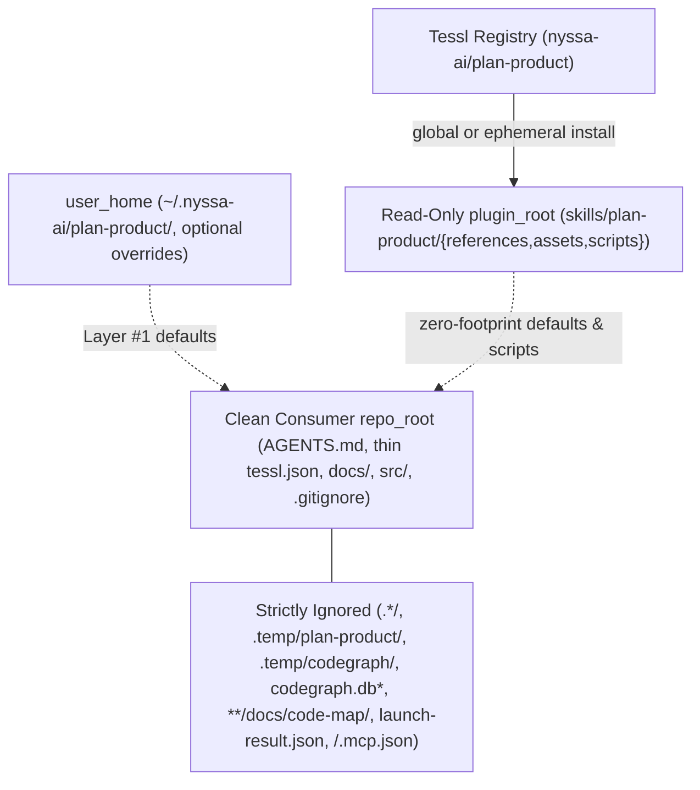

# C-04: External Plugin Isolation & Ephemeral Factory Boundaries

## Summary

`plan-product` leaves zero plugin code, zero vendored configs/templates, zero wrapper skills, and zero checked-in CodeGraph databases inside consuming repositories across both persistent local workstations and ephemeral cloud factories (such as Tessl Cloud). Published to the external Tessl Registry (`nyssa-ai/plan-product`), it resolves Model v2 defaults and starter templates directly from read-only `plugin_root` -> `user_home` (`~/.nyssa-ai/plan-product/`) without scaffolding `.nyssa-ai/plan-product/` into `repo_root`.

Consuming repositories retain only:
- a thin standards note/anchor in `AGENTS.md` (with `@./AGENTS.md` delegates),
- a mandatory thin root `tessl.json` (`"mode": "managed"`, zero `file:` wrappers),
- canonical project-owned `docs/` (zero `docs/code-map/`),
- application `src/` + `test/`, and
- a strict `.gitignore` guaranteeing that `.temp/`, `.codegraph/`, `.tessl/plugins/`, `.cloud-launch/`, `launch-result.json`, `/.mcp.json`, and every `codegraph.db*` file are **never** checked in.

## Core Model / Stages

Keeping plugin code, runtime state, and large SQLite graphs out of consuming repositories separates four concerns:

1. **External Registry & Read-Only Plugin Code (`plugin_root`)**: Skills, workflows, templates, and deterministic scripts live exclusively in `product-planning` (published as `nyssa-ai/plan-product`) and resolve read-only from user-global caches locally (`~/.tessl/plugins/nyssa-ai/plan-product`, `~/.gemini/config/plugins/plan-product`, `~/.claude/plugins/`) or ephemeral caches in Tessl Cloud containers. Because `.tessl-plugin/plugin.json` packages `"skills": "./skills"` (stripping top-level `src/`), zero-dependency runtime mirrors under `skills/plan-product/scripts/` keep `init.mjs`, `migrate.mjs`, and `validate-docs.mjs` fully runnable inside read-only Tessl tiles.
2. **Clean Consuming Repository (`repo_root`)**: Tracks only project-owned files: `AGENTS.md` + delegates, mandatory thin root `tessl.json` (`"mode": "managed"`, pinning `"nyssa-ai/plan-product"` and `"nyssa-ai/dev-standards"` directly from the Tessl Registry with zero `file:` wrappers), canonical Model v2 `docs/` (or `<unit>/docs/` in monorepos, with zero `docs/code-map/`), application source/tests, and a strict `.gitignore`. Default consumer repos have **zero** `.nyssa-ai/plan-product/` files (`--write-config` is strictly an opt-in escape hatch for non-standard `docs/` layouts).
3. **User Defaults & Secrets (`user_home` / Secret Stores)**: Personal cross-repo defaults and custom templates (`~/.nyssa-ai/plan-product/`) live outside `repo_root` and start empty in fresh cloud containers.
4. **Mutable Scratch & Ephemeral CodeGraph (`runtime_root` & `<repo_root>/.temp/`)**: Map-Reduce staging manifests (`.temp/plan-product/<run-id>/`), opt-in telemetry (`<runtime_root>/usage/events.jsonl`, disabled by default), `.cloud-launch/`, clone-root `launch-result.json`, and on-demand CodeGraph SQLite indexes (`.temp/codegraph/<unit-slug>/codegraph.db`) remain strictly ephemeral and untracked.

## Invariants & Rules

### 1. Zero-Footprint Consumer Boundaries & Thin `tessl.json`
- **No Vendored Configs, Copied Templates, or Wrapper Skills:** Never copy `config.json`, `schema.json`, or `templates/` into `repo_root/.nyssa-ai/plan-product/` unless `--write-config` is explicitly requested for non-standard paths; `migrate.mjs` actively prunes copied stock schemas/templates, default-only configs, and retired `docs/code-map/` directories.
- **Thin Root `tessl.json` (Zero Wrappers):** When `tessl.json` exists in `repo_root`, `validate-docs.mjs` deterministically enforces UTF-8 without BOM, `"mode": "managed"`, and zero `"file:"` local wrapper references across `dependencies`, `plugins`, and `tiles`. Delivery action/trigger security hardening is governed by `dev-standards` (`C-01: External Plugin Isolation & Ephemeral Factory Boundaries`).
- **No Skill-Leak Rule:** Never emit `.tessl/plugins/...` paths, `SKILL.md` prompt instructions, or internal workflow text into committed `docs/` files, `## Open Questions & Blockers`, PR comments, or commit messages.

### 2. On-Demand Ephemeral CodeGraph Consumption Boundary
- **Ownership Split:** `dev-standards` owns CodeGraph indexing (`codegraph-mcp.mjs` + `codegraph-preload.cjs` writing exclusively to gitignored `<repo_root>/.temp/codegraph/<unit-slug>/codegraph.db`), local git refresh hooks, and `dev-delivery` Stage 0 / Step 5 sync triggers (see `dev-standards` `C-01`).
- **On-Demand Planning Consumption:** `plan-product` (`references/workflow-development-plan.md`) **never** requires committed `docs/code-map/codegraph.db` snapshots, **never** invokes bare `codegraph`, and **never** creates `.codegraph/` or `docs/code-map/`. When repository source code exists and `codegraph_explore` MCP or `dev-standards`'s `codegraph-mcp.mjs` is available, `plan-development` warms/queries ephemeral `.temp/codegraph/` on demand to populate `- Anchors:` and coupling `- Gotchas:`; on greenfield repos or hosts without `dev-standards`, it bypasses cleanly with zero errors or warnings and omits `- Anchors:`.

### 3. Deterministic `<plugin_root>` & 5-Root Precedence
- **Scripts:** Derive `plugin_root` self-relative via `import.meta.url` (supporting both local `src/` and Tessl-mirrored `skills/plan-product/scripts/`).
- **Skills / Callers:** Resolve `PLAN_PRODUCT_PLUGIN_ROOT` -> `CLAUDE_PLUGIN_ROOT` -> `CURSOR_PLUGIN_ROOT` -> `PLUGIN_ROOT` -> `.tessl/plugins/nyssa-ai/plan-product` -> `~/.tessl/plugins/nyssa-ai/plan-product` -> relative installed path. Never probe retired `.plan-product/`, `.nyssaai/`, or `NYSSA_PLUGIN_STATE_DIR`.
- **Config & Templates:** Resolve strictly `plugin_root` defaults -> `user_home` (`~/.nyssa-ai/plan-product/`) -> rare opt-in `repo_root` override (`<repo_root>/.nyssa-ai/plan-product/config.json`). `runtime_root` resolves in 4 steps (`--runtime-root` -> `NYSSA_RUNTIME_ROOT` -> persona `cwd` with `SOUL.md`+`IDENTITY.md` -> configured `runtimeRoot` or `~/.nyssa-ai/plan-product/runtime/`), keeping telemetry opt-in (`telemetry.enabled === false` by default).

### 4. Deterministic `.gitignore` & Allowed-Set `docs/` Enforcement (`validate-docs.mjs`)
- **`docs/` Lockdown:** Only `GLOSSARY.md`, `product.md`, `features.md`, `tech-stack.md`, `concepts/`, `features/`, `plans/`, `learnings/`, and `specs/` (`*.json` only) are permitted; `docs/code-map/` is prohibited and rejected in both consumer and plugin validation modes.
- **Ordered `.gitignore` Verification:** Whenever `.gitignore` is present (and required whenever `tessl.json`, `.tessl/`, or plugin mode is active), `validate-docs.mjs` enforces:
  1. `docs/` is tracked and never ignored (also checked via `git check-ignore` when `.git/` exists).
  2. `.temp/`, `.codegraph/`, `codegraph.db`, `codegraph.db-wal`, `codegraph.db-shm`, and `**/docs/code-map/` are ignored, and no `!` rule ever whitelists `codegraph.db` or `docs/code-map`.
  3. Whenever `tessl.json` or `.tessl/` exists (or in plugin mode), `.tessl/plugins/`, `.tessl/tiles/`, `.cloud-launch/`, `launch-result.json`, and (in non-plugin consumer repos) `/.mcp.json` are effectively ignored—catching broken parent negations like `!.tessl/` without `.tessl/*`.
  4. See `dev-standards` `C-01` for canonical consumer/plugin `.gitignore` Profile A/B/C templates.

## Participating Features

- [F-00.01: Custom Planning Locations](../features/f-00.01/feature.md) — resolves canonical `docs/` conventions zero-footprint by default, honoring `user_home` defaults and rare opt-in `repo_root` overrides while keeping plugin code and CodeGraph SQLite indexes out of consuming repositories.
- [F-00.03: Customizable Document Templates](../features/f-00.03/feature.md) — resolves starter templates directly from `user_home` or external `plugin_root` (`skills/plan-product/assets/templates/`) without copying template files into consuming repositories.
