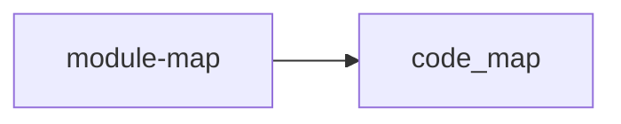

# /ci arch System Architecture Document Plan

## Goal Capsule

Build the planned `/ci arch` feature so the code-indexer plugin can create `docs/code-index/system-architecture.md` from the existing code-index data. The feature should produce:

- A system overview section that is agent-authored and preserved across regeneration.
- A Mermaid component graph rendered from the persisted `docs/code-index/module-map.json` `edges` array.
- A concise module responsibility table and dependency-flow summary derived from `module-map.json`.
- A clear usage boundary: use this artifact for onboarding, cross-module architecture review, and handoff; routine implementation planning still starts from `docs/code-index/index.md` plus the minimum module files.
- Plugin command documentation that tells agents to run the short `/ci arch` workflow through the installed plugin root.

Primary owner module: `module-map`, because it already builds the module model and writes `docs/code-index/module-map.json`.

## Product Contract

### Source Requirement

`docs/features.md` defines F-013 `/ci arch` as a planned command that builds a system-architecture document beside the index:

- Output: `docs/code-index/system-architecture.md`.
- Diagram source: `module-map.json` edges.
- Prose source: agent-authored system overview.
- User surface: `/ci arch`.

`docs/product.md` repeats the same planned capability as a command in the plugin command surface.

### Requirements

REQ-001: `/ci arch` must be the user-facing command phrasing in command docs and skill docs.

REQ-002: The agent-facing command workflow must resolve generator scripts from the installed plugin root, using the same `${PLUGIN_ROOT}` pattern as the current `/ci` command docs:

```powershell
node "${PLUGIN_ROOT}/scripts/module-map/generate.mjs" --arch
```

`node scripts/module-map/generate.mjs --arch` is valid only as a maintainer command from this plugin checkout.

REQ-003: The architecture document must be written to `docs/code-index/system-architecture.md`.

REQ-004: The architecture document must include a Mermaid graph whose nodes are modules and whose directed edges come from the top-level `edges` array in `docs/code-index/module-map.json`.

REQ-005: The architecture document must include an agent-authored system overview. The generator must scaffold and preserve a marked overview region rather than attempting to author the final narrative itself. The `/ci arch` command must ask the agent to enrich that region from generated module docs and product docs.

REQ-006: The feature must work on Windows PowerShell with the existing no-extra-dependency plugin policy.

REQ-007: Existing generation flows must not change behavior unless `--arch` is requested.

REQ-008: Tests must cover diagram rendering, markdown structure, marked-region preservation, Mermaid ID collision handling, no-edge graphs, CLI routing, JSON success output, and JSON failure output.

REQ-009: The command and generated document must state the usage boundary: `system-architecture.md` is for repo onboarding, cross-module architecture review, and human handoff. It is not the default context artifact for routine implementation planning.

REQ-010: `--arch --json` must emit parseable JSON for both success and failure, with stable fields for agents and scripts.

## Planning Contract

### Current System Fit

`scripts/module-map/generate.mjs` already owns the command router for module-map actions such as `--init`, `--doctor`, `--migrate`, `--json`, and normal generation. It also already builds the module model and writes generated docs under `docs/code-index/`.

`scripts/module-map/lib/render.mjs` owns generated markdown for index and module scope docs. The architecture output should use the same style, but it is a distinct document type. Add a dedicated renderer file rather than folding more responsibility into `render.mjs`.

`scripts/lib/` contains shared root and ast-grep utilities. The arch feature should not need shared-library changes unless tests reveal an existing path helper needs reuse.

### Key Technical Decisions

KTD-001: Implement `/ci arch` as command guidance plus one low-level generator flag.

The plugin command file should instruct agents that `/ci arch` means resolving the plugin root, ensuring the index is fresh, then running:

```powershell
node "${PLUGIN_ROOT}/scripts/module-map/generate.mjs" --arch
```

This keeps the user-facing command short while preserving the existing installed-plugin architecture. Bare repo-local script paths belong only in maintainer docs and local verification steps.

KTD-002: Preserve agent-authored prose inside a generated artifact.

The planned feature says "agent-authored system-overview prose." The generator cannot depend on an LLM, but it can preserve agent prose. `system-architecture.md` should contain marked regions:

```markdown
<!-- code-index:system-overview:start -->
Agent-authored overview goes here.
<!-- code-index:system-overview:end -->
```

On first generation, the region contains a short scaffold. On later runs, the generator reads the existing file and preserves the region content. The `/ci arch` command asks the agent to enrich the preserved overview after the deterministic sections are regenerated.

KTD-003: Add a new renderer module with a normalized architecture payload.

Create `scripts/module-map/lib/architecture.mjs` with pure rendering helpers:

- `loadArchitectureModel(repoRoot, config)`
- `renderSystemArchitecture(architectureModel, options)`
- `renderArchitectureMermaid(architectureModel)`
- `preserveMarkedRegion(existingMarkdown, regionName, fallbackMarkdown)`
- `createMermaidNodeIds(modules)`

Use a single `ArchitectureModel` input shape:

```json
{
  "schemaVersion": "1.0",
  "generated": "2026-06-30T00:00:00.000Z",
  "project": { "name": "code-indexer" },
  "modules": [
    {
      "id": "module-map",
      "name": "module-map",
      "root": "scripts/module-map",
      "description": "Module-graph generator.",
      "capabilities": ["Feature code under scripts/module-map/"],
      "dependsOn": ["code-map"],
      "usedBy": ["code-map"],
      "planningModule": "docs/code-index/modules/module-map.md"
    }
  ],
  "edges": [{ "from": "module-map", "to": "code-map" }],
  "codeMap": "docs/code-index/code-map.json",
  "stats": { "moduleCount": 1, "routeCount": 0 }
}
```

The renderer consumes this normalized shape. Tests may construct it directly and must also cover loading it from persisted `module-map.json`.

KTD-004: Render from persisted `module-map.json`.

The low-level `--arch` path loads `docs/code-index/module-map.json`, normalizes it into `ArchitectureModel`, and writes `docs/code-index/system-architecture.md`. It does not rebuild the module model or rewrite module docs. This guarantees the architecture document's graph and tables match the committed module-map artifact.

The agent-facing `/ci arch` workflow owns freshness: it must run the existing staleness gate and run normal `/ci` first when `docs/code-index/index.md`, `docs/code-index/module-map.json`, or source inputs are stale or missing. Then it runs `--arch`.

KTD-005: Keep deterministic sections diff-friendly.

Sort modules and edges before rendering. Use the `generated` value from `module-map.json` rather than creating a new timestamp for architecture rendering. Determinism applies to generated sections; preserved agent-authored regions are stable because their existing content is retained.

KTD-006: Keep the public flag surface small.

Implement `--arch` only. Do not add `--architecture` unless a harness later proves it needs the long spelling.

## Implementation Units

### U-001: Architecture Renderer

Files:

- `scripts/module-map/lib/architecture.mjs`
- `test/module-map/architecture-render.test.mjs`

Work:

- Add a pure renderer for `docs/code-index/system-architecture.md`.
- Add `loadArchitectureModel(repoRoot, config)` or equivalent normalization from persisted `module-map.json`.
- Render these sections:
  - `# System Architecture`
  - `## Use This When`
  - `## System Overview`
  - `## Component Diagram`
  - `## Module Responsibilities`
  - `## Dependency Flows`
- Preserve the `system-overview` marked region when the file already exists.
- Render Mermaid with fenced `mermaid` code:



- Create collision-proof Mermaid node IDs. Sanitization alone is not enough; if two module IDs sanitize to the same value, append deterministic suffixes while keeping labels readable.
- Escape Mermaid labels that include quotes, brackets, or path-like values.
- For no dependency edges, render module nodes and a short no-cross-module-edge note.

Acceptance:

- Unit tests can call the renderer with an in-memory `ArchitectureModel` and get stable markdown.
- Unit tests load a fixture shaped like `module-map.json` and prove top-level `edges` drive the graph.
- Unit tests prove colliding module IDs remain distinct in Mermaid output.
- Unit tests prove existing overview content inside markers survives regeneration.
- The renderer never emits absolute local filesystem paths.
- Output can be committed as generated markdown with preserved agent-authored regions.

### U-002: `--arch` CLI Path

Files:

- `scripts/module-map/generate.mjs`
- `test/module-map/generate-arch.test.mjs`

Work:

- Add `--arch` argument handling only.
- Add `runArchitecture()` near the existing command runners.
- Load config, load persisted `docs/code-index/module-map.json`, normalize it into `ArchitectureModel`, render `system-architecture.md`, and write that file only.
- Return an architecture result object for both text and JSON output:

```json
{
  "ok": true,
  "wrote": ["docs/code-index/system-architecture.md"],
  "modules": 3,
  "edges": 4,
  "warnings": [],
  "errors": [],
  "summary": "3 modules -> docs/code-index/system-architecture.md"
}
```

- On missing or invalid `module-map.json`, zero modules, or write failure, return the same shape with `ok: false`, `wrote: []`, populated `errors`, parseable `--json` output, and exit code 1.
- Keep existing `--doctor`, `--migrate`, `--init`, pin/unpin, and default generation behavior unchanged.

Acceptance:

- `node scripts/module-map/generate.mjs --arch` writes only `docs/code-index/system-architecture.md` from persisted `module-map.json`.
- `node scripts/module-map/generate.mjs --arch --json` prints parseable JSON on success and failure.
- If `module-map.json` is missing or malformed, `--arch` fails clearly instead of silently generating from partial data.
- Existing tests for generation, doctor, bootstrap, and pin/unpin still pass.

### U-003: `/ci arch` Command Surface

Files:

- `skills/using-code-indexer/SKILL.md`
- `commands/ci.md`
- `commands/code-indexer.md`
- `README.md`
- `.codex/INSTALL.md`
- `scripts/module-map/README.md`

Work:

- Treat `skills/using-code-indexer/SKILL.md` as the canonical behavior source for `/ci arch`.
- Keep `commands/ci.md` and `commands/code-indexer.md` as thin wrappers that invoke the skill and point at the canonical flow.
- Document `/ci arch` as:
  1. Check whether the code index is stale using existing `/ci` staleness rules.
  2. If stale or missing, run normal `/ci` first.
  3. Run `node "${PLUGIN_ROOT}/scripts/module-map/generate.mjs" --arch`.
  4. Enrich the preserved `System Overview` region when the user asked for an architecture narrative.
- Use `${PLUGIN_ROOT}` in consumer-facing command docs. Mention `CODE_INDEXER_PLUGIN_ROOT`, `CLAUDE_PLUGIN_ROOT`, `CURSOR_PLUGIN_ROOT`, or the installed plugin directory exactly as the current `/ci` docs do.
- Mention `node scripts/module-map/generate.mjs --arch` only as a maintainer shortcut from this plugin checkout.
- Keep README, INSTALL, and maintainer README to a short mention plus the low-level command; do not duplicate the full workflow in every file.

Acceptance:

- A user can discover `/ci arch` without reading implementation files.
- The old `/code-indexer` alias still works conceptually.
- Consumer-facing docs do not tell agents to run bare `scripts/module-map/generate.mjs` from arbitrary target repos.
- Install docs mention that `/ci arch` ships with the same plugin package.
- Command docs preserve the plugin's context discipline: routine implementation planning uses `docs/code-index/index.md` plus the minimum module files; `system-architecture.md` is for onboarding, cross-module review, and handoff.

### U-004: Product Docs And Generated Artifact

Files:

- `docs/features.md`
- `docs/product.md`
- `docs/roadmap.md`
- `docs/code-index/system-architecture.md`
- `docs/code-index/index.md`
- `docs/code-index/module-map.json`

Work:

- Before verification, update product docs only to describe the intended `/ci arch` behavior and generated artifact.
- Run the generator to create the first architecture document for this repo.
- Regenerate the code index after code changes so module docs include the new renderer and CLI path.
- After tests, doctor, plugin validation, and reinstall all pass, mark F-013 as shipped.

Acceptance:

- `docs/code-index/system-architecture.md` exists and reflects the current `module-map`, `code-map`, and `lib` modules from `module-map.json`.
- Product docs do not describe `/ci arch` as shipped until verification has passed.
- Generated index timestamps are updated by the generator, not manually edited.

### U-005: Verification And Packaging

Files:

- `test/module-map/*.test.mjs`

Verification inputs:

- `package.json`
- `.codex-plugin/plugin.json`
- Installed Codex plugin cache after `codex plugin add code-indexer@personal --json`

Work:

- Run the focused test suite and full test suite.
- Validate the Codex plugin manifest and packaged content.
- Reinstall the personal plugin cache after the feature is implemented.
- Verify the installed cache includes updated command docs and scripts, not only that the manifest validates.

Verification commands:

```powershell
npm test
node scripts/code-map/generate-code-map.mjs
node scripts/module-map/generate.mjs
node scripts/module-map/generate.mjs --arch
node scripts/module-map/generate.mjs --arch --json
node scripts/module-map/generate.mjs --doctor
python C:\Users\jmayn\.codex\skills\.system\plugin-creator\scripts\validate_plugin.py C:\Users\jmayn\plugins\code-indexer
codex plugin add code-indexer@personal --json
```

Acceptance:

- Tests pass.
- `--arch --json` succeeds and failure tests prove JSON stays parseable.
- `--doctor` passes.
- Plugin validation passes.
- Installed plugin cache includes the updated `/ci` command, `/code-indexer` alias, `skills/using-code-indexer`, and `scripts/module-map/generate.mjs`.

## Verification Contract

| Scenario | Command | Expected Result |
|----------|---------|-----------------|
| Full regression | `npm test` | All tests pass. |
| Generate code map | `node scripts/code-map/generate-code-map.mjs` | `docs/code-index/code-map.json` updates successfully. |
| Generate module map | `node scripts/module-map/generate.mjs` | Index, module docs, and `module-map.json` update successfully. |
| Generate architecture | `node scripts/module-map/generate.mjs --arch` | `docs/code-index/system-architecture.md` is created or refreshed from `module-map.json`. |
| JSON arch success | `node scripts/module-map/generate.mjs --arch --json` | Stdout is valid JSON with output path, module count, edge count, warnings, and errors. |
| JSON arch failure | Temporarily run `--arch --json` in a fixture with missing `module-map.json` | Stdout is valid JSON with `ok: false`; process exits 1. |
| Preserved overview | Run `--arch`, edit content between overview markers, run `--arch` again | Agent-authored overview content remains. |
| Mermaid collision | Unit test with IDs that sanitize to the same token | Diagram contains distinct Mermaid node IDs and readable labels. |
| Health check | `node scripts/module-map/generate.mjs --doctor` | No missing required files or broken generator assumptions. |
| Plugin validation | `python C:\Users\jmayn\.codex\skills\.system\plugin-creator\scripts\validate_plugin.py C:\Users\jmayn\plugins\code-indexer` | Manifest and packaged plugin files validate. |
| Personal plugin reinstall | `codex plugin add code-indexer@personal --json` | Codex cache contains the updated `/ci` command, skill, and arch implementation. |

Manual review:

- Open `docs/code-index/system-architecture.md`.
- Confirm the Mermaid graph renders in a Markdown viewer.
- Confirm module responsibility rows match `docs/code-index/module-map.json`.
- Confirm the generated document says when to use it and when not to use it.
- Confirm there is no unsupported claim about runtime behavior that is not present in the code index or agent-authored overview.

## Definition of Done

- `/ci arch` is documented as the preferred user command.
- Consumer-facing command docs resolve scripts through `${PLUGIN_ROOT}`, not bare repo-local paths.
- `node scripts/module-map/generate.mjs --arch` writes `docs/code-index/system-architecture.md` from persisted `docs/code-index/module-map.json` when run from this plugin checkout or a bootstrapped project with the script available.
- The architecture document includes usage boundary, preserved system overview, Mermaid component graph, module responsibilities, and dependency flows.
- Mermaid graph nodes and edges are deterministic, escaped, and collision-proof.
- Existing generation, doctor, and bootstrap behavior is unchanged.
- Tests cover renderer behavior, marked-region preservation, Mermaid collisions, CLI routing, JSON success, and JSON failure.
- `npm test`, generation commands, `--doctor`, plugin validation, and personal plugin reinstall succeed.
- F-013 is updated from planned to shipped in docs only after verification.

## Appendix

### Target File Tree

```text
code-indexer/
|-- commands/
|   |-- ci.md                         # thin wrapper for /ci arch
|   `-- code-indexer.md               # alias docs stay in sync
|-- docs/
|   |-- plans/
|   |   `-- 2026-06-30-001-feature-ci-arch-plan.md
|   `-- code-index/
|       |-- system-architecture.md     # generated doc with preserved overview region
|       |-- module-map.json            # source model for architecture graph
|       `-- modules/
|-- scripts/
|   `-- module-map/
|       |-- generate.mjs               # adds --arch routing
|       `-- lib/
|           `-- architecture.mjs       # new pure renderer and module-map loader
|-- skills/
|   `-- using-code-indexer/
|       `-- SKILL.md                   # canonical /ci arch behavior
`-- test/
    `-- module-map/
        |-- architecture-render.test.mjs
        `-- generate-arch.test.mjs
```

### Implementation Order

1. Add pure renderer, module-map loader, preservation helpers, and unit tests.
2. Add `--arch` CLI routing and command-level tests.
3. Generate `docs/code-index/system-architecture.md`.
4. Update command, skill, README, INSTALL, and maintainer docs without marking F-013 shipped.
5. Regenerate code index.
6. Run tests, `--doctor`, plugin validation, and personal plugin reinstall.
7. Mark F-013 shipped in product docs after verification passes.
