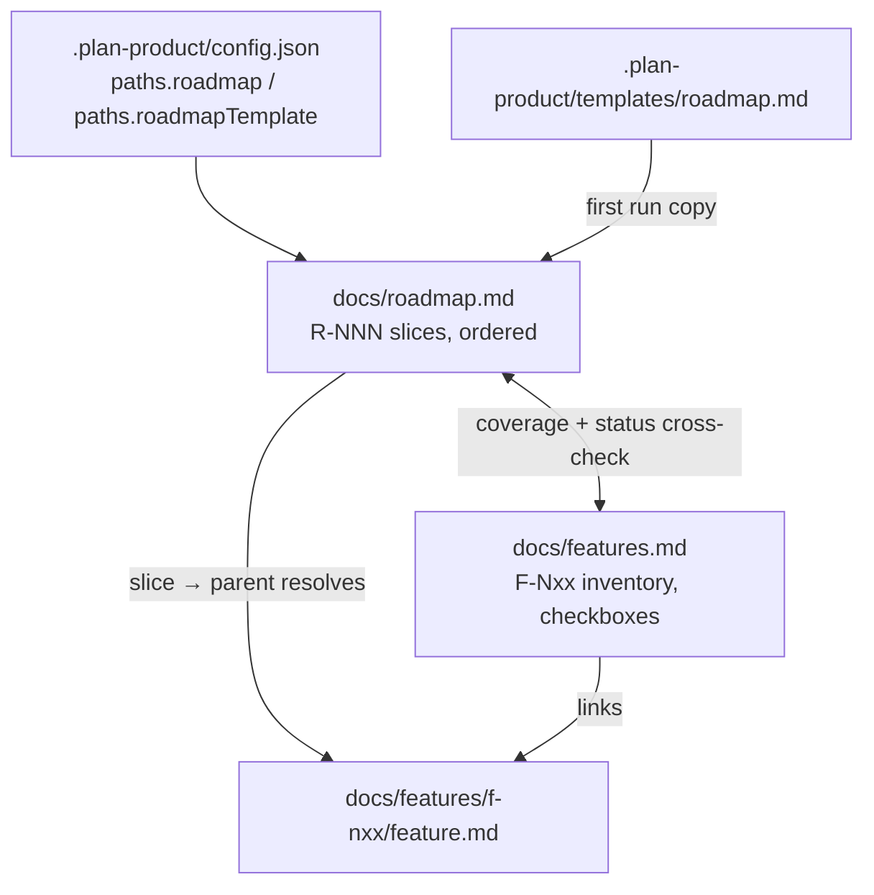
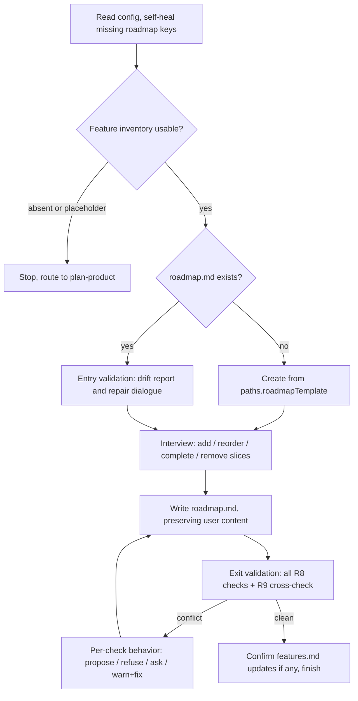

# feat: Add dependency-ordered roadmap artifact and plan-roadmap skill

## Summary

Add `docs/roadmap.md` — an ordered list of work slices with stable `R-NNN` IDs, each tied to one parent feature guide — plus a `plan-roadmap` skill that authors it and enforces tie-out with `docs/features.md`. Ship the template through bootstrap, register the skill across harness docs, and extend the content-assertion test suite.

---

## Problem Frame

Feature IDs encode product phases (`F-Nxx`), but technical dependencies force a build order that interleaves features across phases. `docs/features.md` cannot express that order without distorting the inventory. The pre-2.0.0 roadmap was a milestone checklist duplicating phases and was removed; this artifact owns a different job — dependency-driven implementation sequence — with an explicit boundary: `features.md` keeps inventory, status, and phases; `roadmap.md` owns ordering and slicing (see origin: docs/brainstorms/2026-07-29-roadmap-implementation-order-requirements.md).

---

## Requirements

**Artifact contract**

- R1. `docs/roadmap.md` holds an ordered list of work slices; document order is the implementation order.
- R2. Each slice carries a stable `R-NNN` ID, exactly one parent feature reference linking `docs/features/f-nxx/feature.md`, a completion checkbox, and an optional `after:` list of slice or feature IDs.
- R3. IDs are never renumbered or reused; the next ID is the highest ever assigned plus one, and removing a slice triggers cleanup of `after:` references that point at it.
- R4. Completed slices are immutable history; rework on a shipped feature is a new slice, and a completed slice sitting above its incomplete dependency is informational, not a violation.

**Config and packaging**

- R5. `.plan-product/config.json` gains `paths.roadmap` and `paths.roadmapTemplate`; `.plan-product/schema.json` enumerates both under `paths.properties` and adds a `structure.roadmap` block (schema change is mandatory — `structure` has `additionalProperties: false`).
- R6. The template ships at `.plan-product/templates/roadmap.md` and reaches target repos through bootstrap's template-copy list; `docs/roadmap.md` itself is never scaffolded by `--init` — the skill creates it.

**plan-roadmap skill behavior**

- R7. The skill creates `docs/roadmap.md` from `paths.roadmapTemplate` on first run and updates it afterward — add, reorder, complete, and remove slices through an interview — preserving user-authored content unless the user chooses to replace it.
- R8. Validation runs at skill entry (drift repair before the interview) and again before finishing: every slice resolves to an existing feature guide; every incomplete `F-Nxx` feature is covered by at least one slice (complete features and `CM-xxx` entries exempt); no open slice appears before a declared `after:` dependency; every `after:` reference resolves, with no cycles, self-references, or duplicate/malformed IDs.
- R9. Status cross-check flags a feature marked complete in `docs/features.md` with an open slice, and a feature whose slices are all complete but which is unchecked; with user confirmation the skill may update the `features.md` checkbox and phase progress table to resolve the latter.
- R10. Degenerate states stop cleanly: missing or placeholder feature inventory routes the user to `plan-product`; unparseable roadmap lines are preserved and flagged, never silently dropped.
- R11. Missing config keys self-heal: the skill fills only the absent `paths`/`structure.roadmap` entries with defaults (`docs/roadmap.md`, `.plan-product/templates/roadmap.md`), preserving all other keys — matching plan-product's existing rule; when the repo-local `.plan-product/schema.json` lacks the roadmap entries, the skill inserts the `structure.roadmap` block and the two `paths` property enumerations there too, preserving all other schema content.

**Ecosystem integration**

- R12. `commands/plan-roadmap.md` carries `description` and `argument-hint` frontmatter, an explicit skill-delegation line, and a `## Writes` list — the missing-delegation-line bug from commit `ef3ee53` must not recur.
- R13. Capability lists update in lockstep: README capabilities table and Codex skill list, plus AGENTS.md and CLAUDE.md (identical twins except line 3) — Capabilities bullet and Required Structure tree entry for `docs/roadmap.md`.
- R14. Tests cover the template contract, skill validation phrases, command-doc path references, npm pack payload, and the bootstrap copy list; the existing assertion that `scripts/bootstrap-templates/docs-roadmap.md` does not exist stays.
- R15. `plan-feature` and `plan-product` gain a one-line closing reminder to run `plan-roadmap` when features change and a roadmap exists.
- R16. Dogfood: the roadmap capability is registered as a feature in this repo (guide + inventory entry) and this repo's first real `docs/roadmap.md` is created with the new conventions.

---

## Key Technical Decisions

- **Skill-enforced validation, no validator script**: all four check families are SKILL.md instructions, mirroring `plan-feature`'s consistency-check pattern (`skills/plan-feature/SKILL.md:52-57`). Keeps zero new runtime machinery per the dependency policy; a script can be retrofitted if drift appears (see origin).
- **Template delivery via bootstrap copy list**: one line in `scripts/module-map/lib/bootstrap.mjs`'s template loop. The origin's "bootstrap untouched" boundary is narrowed (confirmed with the user): without this, target repos never receive the template and `paths.roadmapTemplate` dangles. `docs/roadmap.md` itself still gets no `writeIfMissing`.
- **Per-check failure behavior**: coverage gaps are proposed as new slices during the interview; ordering violations and cycles are never written (the skill refuses or offers a deterministic reorder); dangling references raise a blocking question (reassign, remove, or route to `plan-feature`); status conflicts warn with an offered fix. One sentence per behavior in the skill; this is the highest-variance implementation area without it.
- **Write authority on features.md is confirmation-gated**: `plan-roadmap` may update the checkbox and progress table only after the user confirms, so completing a feature's last slice doesn't strand an unresolvable warning while `plan-feature` retains primary ownership.
- **Slice line format is a single parseable list item**: checkbox, ID, short title, parent feature link, optional `after:` — minimal enough that the parse contract (ID + parent + checkbox) is checkable by instruction-following agents without code. Exact wording finalized in the template (U1).
- **`structure.roadmap` mirrors `structure.features`**: `file` and `idPattern: "R-NNN"` keys, optional in `structure.required` following the `patterns` precedent (`.plan-product/schema.json:52, 89-100`).

---

## High-Level Technical Design

Artifact relationships — what validates against what:



Skill run lifecycle (directional guidance, not implementation specification):



---

## Output Structure

```text
.plan-product/templates/roadmap.md    new template
skills/plan-roadmap/SKILL.md          new skill
commands/plan-roadmap.md              new command doc
docs/roadmap.md                       dogfood artifact (this repo)
docs/features/f-301/feature.md        dogfood feature guide
```

Modified: `.plan-product/config.json`, `.plan-product/schema.json`, `scripts/module-map/lib/bootstrap.mjs`, `README.md`, `AGENTS.md`, `CLAUDE.md`, `docs/features.md`, `skills/plan-feature/SKILL.md`, `skills/plan-product/SKILL.md`, and four test files.

---

## Implementation Units

### U1. Roadmap template and config contract

- **Goal:** Define the artifact's shape: template plus config/schema entries.
- **Requirements:** R2, R5, R6 (partial — template location).
- **Dependencies:** none.
- **Files:** `.plan-product/templates/roadmap.md` (new), `.plan-product/config.json`, `.plan-product/schema.json`.
- **Approach:** Template mirrors `.plan-product/templates/features.md`'s shape — title, "How to Use" rules block (ID stability, position-is-order, `after:` semantics, completed-slice immutability), then an example slice list. Config adds `paths.roadmap: "docs/roadmap.md"` and `paths.roadmapTemplate: ".plan-product/templates/roadmap.md"`. Schema enumerates both under `paths.properties` and adds `structure.roadmap` (`file`, `idPattern`) — not added to `structure.required`, following the `patterns` precedent.
- **Technical design (directional):** slice line shape `- [ ] R-001 — Short title — [F-201](features/f-201/feature.md) — after: R-000`. Feature-ID `after:` targets mean "after all existing slices of that feature"; a slice naming its own parent is malformed.
- **Patterns to follow:** `.plan-product/templates/features.md` (rules-block style), `structure.features` (`.plan-product/config.json:27-37`).
- **Test scenarios:** Covers AE1 (rules text states insertion takes next unused number, no renumbering). Contract assertions land in U6; this unit is verified by schema validity: config parses and validates against the updated schema.
- **Verification:** `npm test` green; the new template contains no `F-Nxx` placeholder that could seed a fake slice.

### U2. Bootstrap template delivery

- **Goal:** Ship the template to target repos on `--init`.
- **Requirements:** R6.
- **Dependencies:** U1.
- **Files:** `scripts/module-map/lib/bootstrap.mjs`, `test/module-map/bootstrap.test.mjs`.
- **Approach:** Add `'roadmap.md'` to the template-copy loop (`bootstrap.mjs:131-139`). No `writeIfMissing` for `docs/roadmap.md`. Update the bootstrap test's expected template set.
- **Test scenarios:** `--init` in a fresh directory creates `.plan-product/templates/roadmap.md`; `--init` does not create `docs/roadmap.md`; an existing modified template is not overwritten (writeIfMissing semantics).
- **Verification:** `npm test` green; a scratch `--init` run shows the template copied and no roadmap doc scaffolded.

### U3. plan-roadmap skill

- **Goal:** The skill that authors, updates, and validates the roadmap.
- **Requirements:** R1, R3, R4, R7, R8, R9, R10, R11.
- **Dependencies:** U1.
- **Files:** `skills/plan-roadmap/SKILL.md` (new).
- **Approach:** Compact rules-driven archetype (`plan-feature`, ~60-80 lines): two-field frontmatter (`name`, `description` with a "Use when..." trigger clause naming `docs/roadmap.md`), `## Operating Rules`, numbered `## Workflow`. Config-first step one; self-heal missing keys (R11); degenerate-state stops (R10); entry validation before the interview and exit validation before finishing (R8), with the per-check behaviors from Key Technical Decisions; confirmation-gated `features.md` checkbox/progress-table updates (R9); read `paths.roadmapTemplate` immediately before first-run creation, and when it resolves to a nonexistent file, run the `--init` restore chain (`writeIfMissing` copies the bundled template without touching existing files) and re-check before stopping — the recovery rule `skills/plan-product/SKILL.md:21` already prescribes; preservation rule verbatim from the other skills; final no-placeholders/no-fake-links check.
- **Patterns to follow:** `skills/plan-feature/SKILL.md` (structure, consistency-check step, `[inferred]` convention), `skills/plan-product/SKILL.md:46` (self-heal rule), `skills/plan-product/SKILL.md:14,21` (missing-config bootstrap chain).
- **Test scenarios** (behavioral spec the skill text must encode; asserted as phrases in U6):
  - Covers AE1. Insert between existing slices → next unused number, position mid-list, no renumbering.
  - Covers AE2. Slice above its declared `after:` dependency → flagged, violating order never written.
  - Covers AE3. Incomplete feature with no slice → proposed as a new slice during the interview.
  - Covers AE4. Feature checked complete with an open slice → warned with offered fix.
  - `after:` naming a removed slice → blocking question (reassign / remove / route to plan-feature).
  - Cycle R-002↔R-003 → refused with a deterministic reorder offer.
  - Completed slice above incomplete dependency → informational note only.
  - Placeholder inventory (`F-001: Example foundation feature`) → stop, route to plan-product, no slice seeded.
- **Verification:** Skill text contains every `paths.*` token U6 asserts; a dry run of the skill on this repo (U7) exercises first-run creation and validation.

### U4. Command doc and capability registration

- **Goal:** Expose the skill across harnesses and keep the docs truthful.
- **Requirements:** R12, R13.
- **Dependencies:** U3.
- **Files:** `commands/plan-roadmap.md` (new), `README.md`, `AGENTS.md`, `CLAUDE.md`.
- **Approach:** Command doc mirrors `commands/plan-feature.md`: frontmatter `description` + `argument-hint`, "Load the `plan-roadmap` skill and follow its workflow" delegation line, `## Writes` listing `paths.roadmap` (and `paths.features` for the confirmation-gated cross-update). README: capabilities table row + Codex skill list entry (`plan-product:plan-roadmap`). AGENTS.md/CLAUDE.md: Capabilities bullet + `docs/roadmap.md` line in the Required Structure tree; keep the twins byte-identical except line 3; do not touch the auto-generated module-map section.
- **Test scenarios:** Test expectation: none in this unit — content assertions land in U6 (command-docs and manifest tests).
- **Verification:** `npm test` green; `diff AGENTS.md CLAUDE.md` shows only the line-3 difference.

### U5. Cross-skill roadmap reminders

- **Goal:** Keep the roadmap from silently drifting when features change.
- **Requirements:** R15.
- **Dependencies:** U3.
- **Files:** `skills/plan-feature/SKILL.md`, `skills/plan-product/SKILL.md`.
- **Approach:** One closing-step line in each, adjacent to their inventory-update steps: when the configured roadmap file exists and features changed, remind the user to run `plan-roadmap`. The reminder is a pointer — these skills never edit the roadmap themselves.
- **Test scenarios:** Test expectation: none — one-line doc nudge; existing phrase-assertion tests must still pass (the added line must not trip `assert.doesNotMatch` patterns in `test/module-map/plan-product-templates.test.mjs:59-69`).
- **Verification:** `npm test` green.

### U6. Test suite extensions

- **Goal:** Lock the new contract into the content-assertion suite.
- **Requirements:** R14.
- **Dependencies:** U1, U2, U3, U4.
- **Files:** `test/module-map/plan-product-templates.test.mjs`, `test/module-map/command-docs.test.mjs`, `test/module-map/plugin-manifests.test.mjs`.
- **Approach:** Roadmap assertions go in a plan-roadmap-specific test (the existing template loop asserts mentions in the *plan-product* skill, which won't reference roadmap paths). Follow the `assert.match` / `assert.doesNotMatch` regex style.
- **Test scenarios:**
  - `config.paths.roadmapTemplate` is a string and the file exists; same for `paths.roadmap` being declared.
  - `skills/plan-roadmap/SKILL.md` contains the literal tokens `paths.roadmapTemplate` and `paths.roadmap`.
  - Skill phrase-presence: the four R8 check families, `after:`, "never renumber", and the placeholder-inventory stop.
  - `commands/plan-roadmap.md` references its configured paths and contains a delegation line (mirror `command-docs.test.mjs:83-114`).
  - `npm pack --dry-run` payload includes `.plan-product/templates/roadmap.md`.
  - Existing assertion that `scripts/bootstrap-templates/docs-roadmap.md` does not exist is untouched and still passes.
- **Verification:** `npm test` green with the new assertions failing if any U1-U4 artifact regresses.

### U7. Dogfood: this repo's roadmap

- **Goal:** Exercise the full workflow on plan-product itself, per repo convention.
- **Requirements:** R16.
- **Dependencies:** U1-U6.
- **Files:** `docs/features.md`, `docs/features/f-301/feature.md` (new), `docs/roadmap.md` (new).
- **Approach:** Register `F-301: Implementation roadmap` under a new `Phase 3 - Roadmap Workflow` (guide from the feature template; inventory entry, checklist row, progress-table row). Create `docs/roadmap.md` following the new skill's workflow: slices for F-301 itself, checked complete as the work lands; all other features are complete and therefore exempt from coverage.
- **Test scenarios:** Test expectation: none — documentation artifacts; U6's assertions plus the skill's own validation are the checks.
- **Verification:** Running `plan-roadmap` against the finished repo reports zero violations.

---

## Scope Boundaries

- No shipped validator script and no `--doctor` integration — retrofit only if drift shows up outside skill runs (see origin).
- No auto-derivation of the roadmap from feature-guide metadata; authored, not generated.
- No renumbering or gap-management machinery; no dates, timelines, or milestone framing.
- `CM-xxx` capability entries never require slices.
- `docs/roadmap.md` is never scaffolded by `--init` — only its template ships.

### Deferred to Follow-Up Work

- `--doctor` staleness signal for roadmap drift, if hand-editing proves common.
- Capturing the features.md-vs-roadmap boundary decision in `docs/solutions/` once the work lands (the repo has no learning-capture loop yet).

---

## Risks & Dependencies

- **Instruction-only validation can miss what code would catch.** Mitigated by the per-check behaviors being explicit skill text and by U6's phrase assertions keeping them present; accepted residual risk per the origin decision.
- **Twin-file drift (AGENTS.md/CLAUDE.md).** Every U4 edit must land in both; verification includes a diff check.
- **Stale target-repo configs.** Repos bootstrapped before this change lack roadmap keys, the updated schema, and the template file. Three upgrade paths divide the work: R11's self-heal fills config keys and patches the repo-local schema; the `--init` restore chain materializes the missing template (`writeIfMissing` never touches existing files).

---

## Sources

- `docs/brainstorms/2026-07-29-roadmap-implementation-order-requirements.md` — origin; R-IDs and AE-IDs referenced above are carried from it.
- `skills/plan-feature/SKILL.md:12-19, 52-57` — operating-rules and consistency-check pattern U3 mirrors.
- `skills/plan-product/SKILL.md:10, 14, 21, 46` — template-read timing, bootstrap chain, self-heal rule.
- `scripts/module-map/lib/bootstrap.mjs:131-169` — template copy loop U2 extends; no roadmap `writeIfMissing`.
- `.plan-product/schema.json:23-25, 50-53, 89-100` — `paths` additionalProperties, `structure` strictness, `patterns` optional-block precedent.
- `test/module-map/plan-product-templates.test.mjs:9-42` — template contract test shape; line 38 keeps the legacy-path prohibition.
- `test/module-map/command-docs.test.mjs:83-114` — per-skill path-reference assertions U6 mirrors.
- Commit `ef3ee53` — command docs need explicit skill delegation lines (R12's rationale).
- Commit `8571928` — removed the pre-2.0.0 roadmap; commit `0284b8f` — the old "roadmap sequences features by id" boundary that informs the Problem Frame.
