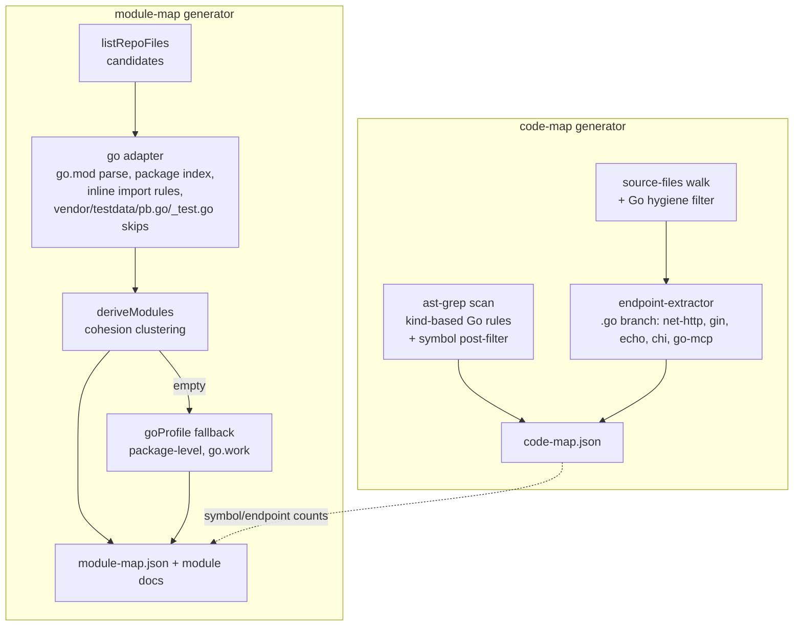

# feat: Go Code-Map Support (F-204)

**Covers roadmap slices:** R-006 (adapter + symbols), R-007 (endpoints), R-008 (fixtures + tests) — see `docs/roadmap.md`.

## Summary

Add Go as the fourth code-map language at parity with TypeScript, C#, and Python: kind-based symbol rules, a Go stack-graph adapter feeding package-level module discovery, regex endpoint extraction for net/http, gin, echo, chi, and MCP, and fixture-backed parity tests.

---

## Problem Frame

Go repos get no code-map context today, and the codebase already flags the gap: `scripts/module-map/lib/adapters/index.mjs` documents that code-map ships Go rules but no adapter can build the Go import graph. What ships today also contradicts F-204's decisions — the existing `goProfile` derives modules from `cmd/*` (not packages), and the two shipped Go rules (`func $NAME($$$)`, `type $NAME $BODY`) miss methods with receivers and can't distinguish struct from interface. This work is reconcile-and-replace, not greenfield.

---

## Requirements

**Symbols and modules**

- R1. Go functions, methods (with receivers), structs, and interfaces are indexed via kind-based ast-grep rules with distinct `mapKind` values.
- R2. Module discovery is package-level: one derivation input per package directory under each `go.mod`, including `go.work` members; the adapter's import graph feeds cohesion-based derivation, with the stack profile as fallback.

**Endpoints**

- R3. The endpoint index detects net/http registrations (`http.HandleFunc`/`Handle`, `ServeMux` — including Go 1.22 `"METHOD /path"` patterns), gin/echo/chi routes, and MCP tool declarations from both mark3labs/mcp-go and the official Go SDK.

**Hygiene**

- R4. `vendor/`, `testdata/`, `*.pb.go`, and `_test.go` files appear in no artifact — symbol index, endpoint index, or module graph.
- R5. Analysis is static via the bundled ast-grep and regex only: no Go toolchain at map time, no new third-party dependencies (AGENTS.md policy).

**Quality**

- R6. Parity tests mirror the existing per-language suites (including byte-stable output) and an end-to-end `map-code` run on a Go fixture succeeds on Windows.
- R7. Scan failures degrade gracefully (warn + empty graph, never throw), matching the existing adapter convention; UC-001's failure wording is aligned to this.

---

## Key Technical Decisions

- **Adapter-first discovery; goProfile becomes the package-level fallback.** Cohesion detection (adapter FileGraph → `deriveModules`) runs before stack profiles, so the adapter is the primary mechanism for R2. The existing `cmd/*`-based `goProfile` is rewritten to package-level with `go.work` awareness and only fires when cohesion yields nothing. Rationale: honors the confirmed package-level choice without a precedence ambiguity.
- **Replace, don't augment, the shipped Go rules.** `map-go-func.yml`/`map-go-type.yml` become kind-based (`function_declaration`, `method_declaration`, `type_spec` with struct/interface distinction). Rationale: the pattern-based rules under-match (no receivers) and can't set distinct kinds; parity tests lock the new contract.
- **Endpoint detection is regex, per the extractor's architecture.** `endpoint-extractor.mjs` dispatches by extension over per-framework regexes; Go adds a `.go` branch with framework strings `net-http`, `gin`, `echo`, `chi`, `go-mcp`. Precision stance: a route match requires a string-literal first path argument starting with `/` (or a `"METHOD /path"` pattern literal), which defuses chi's lowercase `.Get(` colliding with ordinary getters.
- **Router groups get file-scoped static prefix resolution only.** A pre-pass collects `x := y.Group("/prefix")` (gin/echo) and `r.Route("/prefix", ...)` (chi) bindings within a file and prefixes matching routes; anything dynamic or cross-file emits the sub-path with `confidence: 'medium'`. UC-002 gains a present-with-wrong-path triage branch. Rationale: full prefix resolution is the largest effort unknown in R-007; this bounds it without silently wrong paths.
- **Go hygiene filters are Go-scoped; the shared skip sets stay untouched.** `vendor` and `testdata` are Go-adapter skip extras (the existing per-adapter pattern), and `*.pb.go`/`_test.go` are filtered in the adapter's candidate normalization. On the code-map side, Go files are filtered in two places: `source-files.mjs` (the endpoint walk) drops `.go` files under `vendor/`/`testdata/` and matching `*.pb.go`/`_test.go`, and `generate-code-map.mjs` post-filters symbol-scan matches by the same rule — the ast-grep scan walks roots itself and bypasses the file walks entirely, so a walk-side skip alone leaks vendored symbols back into the index and the endpoint file union. Rationale: closes the documented endpoint-leak class for Go without changing cross-language behavior from a Go-scoped plan.
- **Import resolution parses `go.mod` module lines and `go.work` use dirs; `replace` directives are ignored in v1.** Import paths map to package directories by longest module-prefix match; edges are dir-level fan-out with accumulated weights. Blank imports (`import _`) count as edges (real side-effect deps); dot-imports count as edges with no symbol-attribution impact (ownership is file-based). Nested `go.mod` subtrees are excluded from the parent module, matching Go semantics.
- **Graceful degradation, no new abort semantics.** UC-001's "no partial artifacts" promise contradicts the codebase-wide convention (warn + empty graph); the convention wins and UC-001 is amended. Rationale: an abort semantic would be a cross-cutting change to all languages that no slice owns.
- **Single-adapter selection is an accepted existing constraint.** A Go+TypeScript monorepo gets one language's import edges (`selectAdapter` first-match). Acknowledged in UC-001; not F-204's to fix.

---

## High-Level Technical Design

Where Go plugs into the two generator pipelines:

---

## Implementation Units

Slice mapping: U1–U3 land as R-006, U4 as R-007, U5–U6 as R-008.

### U1. Kind-based Go symbol rules and code-map file hygiene

- **Goal:** Go symbols indexed correctly (R1) and generated/test files excluded from the code-map walk (R4).
- **Requirements:** R1, R4, R5.
- **Dependencies:** none.
- **Files:** `scripts/code-map/rules/map-go-func.yml`, `scripts/code-map/rules/map-go-method.yml` (new), `scripts/code-map/rules/map-go-type.yml` (split or metadata-differentiated for struct vs interface), `scripts/code-map/lib/source-files.mjs`, `scripts/code-map/generate-code-map.mjs`, `test/code-map/go-rules.test.mjs` (new).
- **Approach:** Replace pattern-based rules with kind-based ones (`function_declaration`, `method_declaration`, `type_spec` with `struct_type`/`interface_type` refinement), each with `metadata.mapKind` and a `$NAME`-equivalent capture the shared `symbolNameFromMatch` reads. Add the Go hygiene filter in `source-files.mjs` (endpoint walk) and a symbol post-filter in `generate-code-map.mjs` — the ast-grep scan walks roots itself, so matches from `vendor/`/`testdata/` dirs or `*.pb.go`/`_test.go` files must be dropped before symbols are keyed (this also keeps them out of the endpoint file union built from symbol-scan paths).
- **Patterns to follow:** kind-based rules used by other languages in `scripts/code-map/rules/`; `kindRank` dedupe in `generate-code-map.mjs`.
- **Test scenarios:** in `test/code-map/go-rules.test.mjs`, which resolves the bundled ast-grep via `scripts/lib/resolve-ast-grep.mjs` and spawns `scan --config scripts/code-map/sgconfig.yml --json --include-metadata` over temp `.go` fixtures (the existing `extractors.test.mjs` never invokes ast-grep, so it cannot host these): plain func indexed as `function`; pointer-receiver method (`func (s *Server) Handle(...)`) indexed as `method`; `type Foo struct` vs `type Bar interface` get distinct kinds; a `*_test.go` and a `*.pb.go` file yield no symbols.
- **Verification:** the new rule suite passes; scanning a sample Go file yields the four kinds with correct names.

### U2. Go stack-graph adapter

- **Goal:** Static Go import graph with package-level file/symbol data feeding module derivation (R2, R4, R5, R7).
- **Requirements:** R2, R4, R5, R7.
- **Dependencies:** U1 (adapter reuses the shipped rules via `sgconfig.yml`).
- **Files:** `scripts/module-map/lib/adapters/go.mjs` (new), `scripts/module-map/lib/adapters/index.mjs`. Tests land in U5.
- **Approach:** Follow the adapter contract (`types.mjs`): `matches()` = `go.mod`/`go.work` at root or bounded BFS (python.mjs pattern) finding a `go.mod`; `extract()` = normalize candidates (forward-slash, drop `vendor/`, `testdata/`, `*.pb.go`, `_test.go`), parse each `go.mod` `module` line and `go.work` `use` dirs, build package-dir index, extract symbols via `runBatchedScan --config`, extract imports via inline ast-grep rules (TS adapter's `IMPORT_RULES` pattern against `import_spec` nodes), resolve import path → package dir by longest module-prefix match, fan edges dir-level with accumulated weights (`edgeWeights` map, sorted emit). Nested `go.mod` subtrees excluded from the parent. Failures log `warn` and return `{files: [], edges: []}`. Register the adapter at the end of `ADAPTERS` (append after csharp/python/typescript so polyglot repos keep their current winners).
- **Patterns to follow:** `python.mjs` (structure, BFS, determinism), `typescript.mjs` (inline import rules), `csharp.mjs` (compilation-unit context — module line as the namespace analog).
- **Test scenarios:** enumerated in U5 (adapter tests are fixture-driven).
- **Verification:** `selectAdapter` returns the Go adapter for a Go repo; extract on the U5 fixture is deterministic and matches expected edges/symbols.

### U3. Package-level goProfile fallback

- **Goal:** The stack-profile fallback honors package-level discovery instead of `cmd/*`-only (R2).
- **Requirements:** R2.
- **Dependencies:** U2.
- **Files:** `scripts/module-map/lib/stack-profiles/index.mjs`. Tests land in U5.
- **Approach:** Rewrite `goProfile.detect` to emit one ModuleDef per package directory under each `go.mod` (root or `go.work` members), keeping its priority so it still only fires when cohesion detection yields nothing. Keep detection keyed on `go.mod`/`go.work` presence.
- **Patterns to follow:** existing profile contract `{id, priority, detect}` in the same file.
- **Test scenarios:** in U5 — profile yields package modules for a fixture where the adapter graph is artificially empty.
- **Verification:** fallback path produces package-level modules; no `cmd/*`-only behavior remains.

### U4. Go endpoint extraction

- **Goal:** net/http, gin, echo, chi, and MCP endpoints in the endpoint index (R3).
- **Requirements:** R3, R5.
- **Dependencies:** U1 (file hygiene keeps `_test.go` `httptest` noise out).
- **Files:** `scripts/lib/endpoint-extractor.mjs`, `test/code-map/endpoints.test.mjs`.
- **Approach:** Add the `.go` extension branch and per-framework regexes following the existing `*_RE` + `lineAt` shape. net/http: `http.HandleFunc`/`http.Handle`/`mux.HandleFunc`, parsing Go 1.22 `"METHOD /path"` literals into method + path. gin/echo: uppercase `.GET(`-family; chi: titlecase `.Get(`-family plus `r.Method(...)`. All require a string-literal path argument starting with `/` (or a method-pattern literal). File-scoped group-prefix pre-pass per KTD; unresolved groups emit sub-path with `confidence: 'medium'`. MCP: mark3labs `AddTool(mcp.NewTool("name"...)` and official-SDK `mcp.AddTool(server, &mcp.Tool{Name: "..."}` shapes → `kind: 'mcp-tool'`, framework `go-mcp`. Entry shape and dedupe/sort are the shared ones.
- **Patterns to follow:** existing FastAPI/C# regex families in the same file; entry `framework` naming convention (lowercase-hyphenated).
- **Test scenarios:** `http.HandleFunc("/health", h)` → http entry, no method; `mux.HandleFunc("GET /users/{id}", h)` → method `GET`, path `/users/{id}`; gin `r.GET("/users", h)` → gin entry; same-file `g := r.Group("/api/v1")` + `g.GET("/users", h)` → path `/api/v1/users`; chi `r.Get("/orders", h)` → chi entry; `store.Get("key")` (no leading slash) → no entry; echo `e.POST("/login", h)` → echo entry; both MCP SDK shapes → `mcp-tool` entries with names; a route inside `vendor/` or `_test.go` → absent.
- **Verification:** endpoint tests pass; no false positives from the getter-collision scenario.

### U5. Go fixtures and adapter/module tests

- **Goal:** Fixture-backed proof of R1, R2, R4 at the adapter and module layer (R6).
- **Requirements:** R2, R4, R6.
- **Dependencies:** U1, U2, U3.
- **Files:** `test/module-map-adapters/fixtures/go-repo/**` (multi-package `go.mod` with `orders`/`shared`/`users`-style packages, an `internal/` package, a colliding pair `internal/util` + `pkg/util`, a blank import, a `vendor/` decoy with a routed handler, a `*.pb.go` decoy, a `_test.go` decoy, and a nested-module decoy — a `tools/` subdirectory with its own `go.mod`), `test/module-map-adapters/fixtures/non-go-repo/`, `test/module-map-adapters/go.test.mjs`.
- **Approach:** Mirror `python.test.mjs`'s six-test shape with the local `planProductConfig()` helper (`modules.adapter: 'go'`). Fixture stays under `fixtures/` so the parent repo's own walks skip it.
- **Test scenarios:** `matches()` true for go-repo, false for non-go-repo and for a repo whose only `go.mod` is under `fixtures/` (fixture-skip analog); `selectAdapter(root, 'go')` by id; exact `from->to` edge weights including the blank-import edge; symbols per file with kinds; byte-stability (two extracts, identical JSON); `deriveModules` yields package-level modules with the colliding `util` pair kept distinct (by path, not package name); `buildPlanProductModel` `dependsOn`/`usedBy` edges; `vendor/`, `*.pb.go`, `_test.go` contents absent from files, symbols, and edges; the nested `tools/go.mod` subtree's packages and edges absent from the parent module graph; symbol lines are 1-based (the `+1` conversion lives in the adapter path exercised here).
- **Verification:** new suite passes under the existing `npm test` globs (no registration needed).

### U6. End-to-end parity, endpoint-index integration, and doc alignment

- **Goal:** Prove the full `map-code` path on a Go repo and align the F-204 docs with settled semantics (R4, R6, R7).
- **Requirements:** R3, R4, R6, R7.
- **Dependencies:** U4, U5.
- **Files:** `test/code-map/endpoints.test.mjs` (fixture-integration cases), an end-to-end test running the generators against the go-repo fixture (home: `test/module-map/` beside `generate-arch.test.mjs`), `docs/features/f-204/uc-001-map-a-go-repository.md`, `docs/features/f-204/uc-002-verify-go-endpoint-detection.md`.
- **Approach:** Drive `generate-code-map.mjs` + `generate-module-map.mjs` over the Go fixture in a temp copy; assert Go entries in `code-map.json` and `module-map.json` and that the vendored route never reaches the endpoint index (the skip-dirs leak class). Amend UC-001's failure path to graceful-degradation wording and add UC-002's present-with-wrong-path triage branch; add UC-001's one-sentence single-adapter acknowledgment.
- **Test scenarios:** e2e run exits 0 on Windows paths; `code-map.json` contains Go symbols and endpoints; `module-map.json` contains package modules; vendored handler absent from the endpoint index; regenerated artifacts are deterministic across two runs.
- **Verification:** full `npm test` green; UC docs match implemented semantics (no contradiction between UC-001 and adapter behavior).

---

## Scope Boundaries

- gRPC service detection, build-tag analysis, and dynamic route construction — out, per F-204.
- `replace`-directive resolution and generated-code header sniffing (`// Code generated`) — known v1 gaps, recorded here rather than half-built.
- Go detectors for the `find-code-patterns` pattern library — separate tuning surface.
- Multi-adapter mixed-language repos — existing architectural constraint, acknowledged not fixed.

### Deferred to Follow-Up Work

- Cross-file/dynamic router-group prefix resolution (v1 emits sub-path + `confidence: 'medium'`).
- Seed `docs/solutions/` with an "adding a language adapter" learning after F-204 lands (`/ce-compound`) — the learnings search confirmed the capture loop doesn't exist yet.

---

## Risks & Dependencies

- **ast-grep Go support: verified.** The bundled binary (v0.42.3) parses Go with kind-based inline rules and `--include-metadata` — tested during research.
- **Windows path handling is unverified for a new language.** No captured learnings vouch for it; U6's end-to-end run on this Windows repo is the empirical check.
- **Replacing shipped rules changes existing behavior** for any repo already scanning Go files with the coarse rules; the new rules strictly widen coverage (methods, kind distinction), and U1's tests lock the contract.
- **Regex endpoint precision** depends on the literal-path anchor; the getter-collision scenario in U4 guards the known false-positive class.

---

## Sources & Research

- Adapter contract: `scripts/module-map/lib/detection/types.mjs`; selection and the asymmetry comment: `scripts/module-map/lib/adapters/index.mjs`.
- Worked examples: `scripts/module-map/lib/adapters/python.mjs` (structure), `typescript.mjs` (inline import rules), `csharp.mjs` (per-unit context, duplicate-name handling asserted in `test/module-map-adapters/csharp-semantic.test.mjs`).
- Endpoint architecture: `scripts/lib/endpoint-extractor.mjs` (extension dispatch, `*_RE` + `lineAt`, entry shape); leak precedent: `scripts/lib/skip-dirs.mjs` header.
- Existing Go artifacts to reconcile: `scripts/code-map/rules/map-go-func.yml`, `map-go-type.yml`, `goProfile` in `scripts/module-map/lib/stack-profiles/index.mjs`.
- Test template: `test/module-map-adapters/python.test.mjs` + `fixtures/python-repo/`; endpoint tests: `test/code-map/endpoints.test.mjs`.
