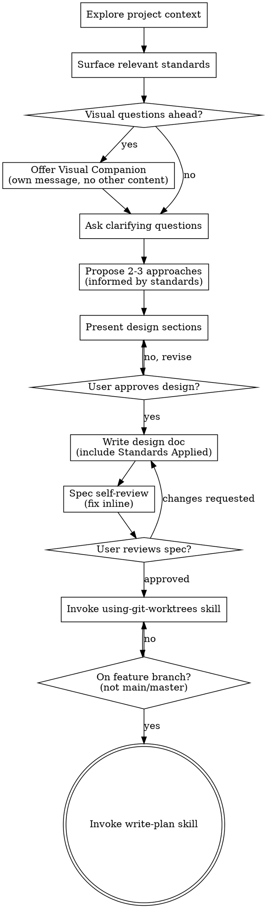

# Design Spec

Help turn ideas into fully formed designs and specs through natural collaborative dialogue.

**Announce at start:** "I'm using the design-spec skill to refine this into a spec."

**Inputs:** a new idea from conversation, OR a backlog item at `docs/agent-plan/backlog/{id}/{id}-detail.md` (from `dev-tools:add-backlog`), OR a bug detail file at `docs/agent-plan/bugs/{bug_id}/{bug_id}-detail.md`, OR a use-case file at `docs/use-cases/f{n}-u{n}.md`.

## Purpose

One canonical path for spec-before-code work:

1. **Explore & refine** — understand intent, surface standards, present design for approval
2. **Write spec** — save to `docs/agent-plan/specs/`, user review gate
3. **Worktree** — isolated feature branch (`using-git-worktrees`)
4. **Plan** — `write-plan` (internal sub-skill)
5. **Hand off** — **execute-plan** when your human partner is ready to implement

## Hard policy

- Do not invoke `write-plan` directly — only via this skill after spec approval and worktree setup.
- Do not invoke `execute-plan-run`, `execute-plan-run-inline`, or `execute-plan-finish` directly — use **execute-plan** when implementing.
- Do not auto-start **execute-plan** from this skill unless your human partner already said go.
- Do not skip `using-git-worktrees` before `write-plan`.
- Do not write code or invoke implementation skills during design-spec.

## Required sub-skills

- dev-tools:using-ai-plan (when repo has code — Step 1 context)
- dev-tools:using-core-standards + applicable `dev-tools:using-*-standards` (Step 2)
- dev-tools:using-git-worktrees (Step 10)
- dev-tools:write-plan (Step 11 — internal; users use **design-spec**)

## Files in this skill

- `references/policy.md` — one-way-in policy text
- `visual-companion.md` — browser companion guide
- `spec-document-reviewer-prompt.md` — optional spec review template

Start by understanding the current project context and any provided input, then ask questions one at a time to refine the idea. Once you understand what you're building, present the design and get user approval.

<HARD-GATE>
Do NOT invoke any implementation skill, write any code, scaffold any project, or take any implementation action until you have presented a design and the user has approved it. This applies to EVERY project regardless of perceived simplicity.
</HARD-GATE>

## Anti-Pattern: "This Is Too Simple To Need A Design"

Every project goes through this process. A todo list, a single-function utility, a config change — all of them. "Simple" projects are where unexamined assumptions cause the most wasted work. The design can be short (a few sentences for truly simple projects), but you MUST present it and get approval.

## Checklist

You MUST create a task for each of these items and complete them in order:

1. **Load input and explore project context** — if starting from a backlog item, read its detail file first (see Backlog item input below); if starting from a bug detail file, read it first (see Bug detail input below); if starting from a use-case file, read it plus the linked feature row (see Use-case input below); check files, docs, recent commits; read `docs/roadmap.md` when implementing a roadmap item. **When the repo has source code, load planning context now — these steps are not optional:**
   1. Check for `docs/agent-plan/context/index.md`
   2. If missing: run `npm run ai-plan` (or the plugin generate scripts) now, before continuing
   3. If present: check staleness — if `index.md` is older than the most recently modified source file, run `npm run ai-plan` before continuing
   4. Read `index.md` now (use the Read tool). Do not summarize or skip. The module capability table is your routing context for the whole design.
   5. When the primary module is identified (see Single module focus below), read `docs/agent-plan/context/modules/<id>.md` now (Read tool) — before the first clarifying question, not later. Do not load other module files.
2. **Surface relevant standards** — detect tech stack, read applicable dev-tools (see Standards Surfacing below)
3. **Offer visual companion** (if topic will involve visual questions) — this is its own message, not combined with a clarifying question. See the Visual Companion section below.
4. **Ask clarifying questions** — one at a time, understand purpose/constraints/success criteria
5. **Propose 2-3 approaches** — with trade-offs and your recommendation (informed by surfaced standards)
6. **Present design** — in sections scaled to their complexity, get user approval after each section
7. **Write design doc** — save to `docs/agent-plan/specs/YYYY-MM-DD-<topic>-design.md` and commit (include Standards Applied section)
8. **Spec self-review** — quick inline check for placeholders, contradictions, ambiguity, scope (see below)
9. **User reviews written spec** — ask user to review the spec file before proceeding
10. **Set up isolated workspace** — REQUIRED SUB-SKILL: invoke `dev-tools:using-git-worktrees` (feature branch + worktree, not main/master)
11. **Write implementation plan** — invoke `dev-tools:write-plan` (only after step 10 completes; write-plan loads one ai-plan module file via `dev-tools:using-ai-plan` when applicable)

## Process Flow



<HARD-GATE>
Do NOT invoke `write-plan` until `using-git-worktrees` has completed and you are on a feature branch (never `main` or `master`). Do NOT invoke frontend-design, mcp-builder, or any other implementation skill during design-spec.
</HARD-GATE>

**After spec approval, the chain is:** `using-git-worktrees` → `write-plan` → **execute-plan** (when partner is ready to implement). Nothing else between worktree and plan.

## Backlog item input

Use when the user asks to start work on a backlog item, names a backlog id, or points at a path under `docs/agent-plan/backlog/`.

**Backlog id format:** `{YYYY.MM.DD-HHMMSS-slug}` (example: `2026.04.24-102847-add-sso-via-okta`).

**Detail file path:** `docs/agent-plan/backlog/{id}/{id}-detail.md`

**If the id is missing but intent is clear** ("work on the SSO backlog item"), list matching directories under `docs/agent-plan/backlog/` or ask which item.

**When a backlog detail file exists, you MUST:**

1. Read the full detail file before asking clarifying questions
2. Announce: "Using backlog item `{id}` as input for this design."
3. Treat these sections as starting requirements — do not re-ask for information already captured unless it is ambiguous, incomplete, or contradictory:
   - **Summary** → what you are building
   - **Context** → why it matters, constraints, stakeholders
   - **Scope** (in / out) → boundaries for the design
   - **Acceptance criteria** → success conditions the spec must satisfy
4. Ask clarifying questions only for **gaps** — technical approach not decided, conflicts between scope and acceptance criteria, missing constraints, decomposition into multiple specs
5. Carry acceptance criteria forward into the spec; refine them during design if needed, but get user approval before changing meaning
6. In the written spec, include a **Source** section (see After the Design)

**Backlog is input, not output.** This skill produces `docs/agent-plan/specs/…-design.md`. Do not edit the backlog detail file during design unless the user explicitly asks to update the backlog item.

## Bug detail input

Use when `dev-tools:fix-bug` classifies a documented bug as complex, or when the user points at a path under `docs/agent-plan/bugs/` and asks to design the fix.

**Bug detail file path:** `docs/agent-plan/bugs/{bug_id}/{bug_id}-detail.md`

When a bug detail file is the input, you MUST:

1. Read the full detail file before asking clarifying questions
2. Announce: "Using bug `{bug_id}` as input for this design."
3. Treat these sections as starting evidence:
   - **Symptom** → observed behavior
   - **Root cause** → known or hypothesized cause
   - **Contributing factors** → relevant context, environment, logs, or recent changes
4. If `fix-bug` already produced a root-cause hypothesis and evidence, carry that forward into the design
5. Ask clarifying questions only for gaps that affect the design: expected behavior, risk, user impact, migration constraints, cross-module boundaries, or acceptance criteria
6. In the written spec, include a **Source** section:
   ```markdown
   ## Source

   **Bug:** `docs/agent-plan/bugs/{bug_id}/{bug_id}-detail.md`
   ```

**Bug detail files are input, not output.** Do not edit the bug detail file during design unless the user explicitly asks.

## Use-case input

Use when the user points at a path under `docs/use-cases/` or names a use-case id (e.g. `F1-U1`).

**Use-case file path:** `docs/use-cases/f{n}-u{n}.md` — frontmatter links it to a feature row in `docs/features.md`.

**When a use-case file is the input, you MUST:**

1. Read the use-case file (summary, process, success criteria)
2. Look up the linked feature row in `docs/features.md` (the `feature:` frontmatter key)
3. Read `docs/product.md` for product context
4. Announce: "Using use-case `{use-case-id}` as input for this design."
5. Carry the use-case **success criteria** forward as spec **acceptance criteria**; refine during design if needed, but get user approval before changing meaning
6. Ask clarifying questions only for **gaps** not covered by the use-case — technical approach, constraints, edge cases the process tree doesn't address
7. In the written spec, include a **Source** section:
   ```markdown
   ## Source

   **Use case:** `docs/use-cases/f{n}-u{n}.md` ({use-case-name})
   **Feature:** {feature-id} — {feature-name} (`docs/features.md`)
   ```

**Use-case files are input, not output.** Do not edit the use-case file during design unless the user explicitly asks.

## Single module focus

**Default:** scope each design to **one primary module** from `docs/agent-plan/context/index.md` when the repo has code.

**During design, encourage your human partner to narrow work to a single module whenever possible.** One module → one spec → one plan → focused implementation.

**When exploring the idea:**

1. Use `index.md` and `module-map.json` to identify which module owns this work
2. If the request clearly spans multiple modules, **propose splitting** into separate specs (one per module) before designing — each gets its own spec → plan → implementation cycle
3. If splitting is impractical, designate exactly one **primary module** and list only **dependency touch points** in other modules (interfaces, not full design in those modules)
4. Ask explicitly when ambiguous: "This looks like it belongs in `{module}` — should we scope this design to that module only?"

**In the written spec**, include:

```markdown
## Module scope

**Primary module:** `{module-id}` (`docs/agent-plan/context/modules/{module-id}.md`)

**Affected modules:** [none | list only modules touched via dependency — not co-designed]
```

**Justify cross-module specs.** If a single spec must span multiple primary modules, state why splitting failed and get user approval before proceeding.

## Standards Surfacing

During step 2, detect the project's tech stack and surface the applicable standards by invoking the matching **bundled** `dev-tools:using-*-standards` skills. Do NOT read `standards/*.md` from the filesystem — skill invocations load content portably via `manifest.json`.

**Detection:** Scan the project for files that indicate the tech stack:

| Files detected                          | Skill to invoke                           |
|-----------------------------------------|-------------------------------------------|
| `.cs`, `.csproj`, `.razor`, `.sln`      | `dev-tools:using-dotnet-standards`    |
| `.tsx`, `.ts`, `next.config.*`          | `dev-tools:using-nextjs-standards`    |
| `.sql`, or Postgres-related config      | `dev-tools:using-postgres-standards`  |
| `.py`, `pyproject.toml`, `setup.py`    | `dev-tools:using-python-standards`    |

**Always invoke** `dev-tools:using-core-standards` in addition to any tech-specific skill above — it covers cross-cutting concerns (project structure, error handling, logging, testing, workflow artifacts) that apply regardless of stack.

**Process:**

1. Detect tech stack from file patterns above
2. Invoke the matching `dev-tools:using-*-standards` skill(s) plus `dev-tools:using-core-standards`
3. Briefly tell the user which standards skills you've loaded — don't dump the content, just list the skill names
4. Let the surfaced standards inform your approach proposals and design decisions
5. If a standard contradicts a design choice, flag the conflict explicitly

**In the design doc:** Include a "Standards Applied" section listing which standards informed the design and any key constraints they impose. This ensures the implementation plan and implementer know which rules to follow.

## The Process

**Understanding the idea:**

- If a backlog detail file was loaded, summarize what you took from it (summary, scope, acceptance criteria) before your first clarifying question — confirm your understanding, don't repeat the whole file
- Check out the current project state first (files, docs, recent commits)
- Before asking detailed questions, assess scope: if the request describes multiple independent subsystems (e.g., "build a platform with chat, file storage, billing, and analytics"), flag this immediately. Don't spend questions refining details of a project that needs to be decomposed first.
- If the project is too large for a single spec, help the user decompose into sub-projects: what are the independent pieces, how do they relate, what order should they be built? Then run **design-spec** on the first sub-project through the normal design flow. Each sub-project gets its own spec → plan → implementation cycle.
- For appropriately-scoped projects, ask questions one at a time to refine the idea
- Prefer multiple choice questions when possible, but open-ended is fine too
- Only one question per message - if a topic needs more exploration, break it into multiple questions
- Focus on understanding: purpose, constraints, success criteria

**Exploring approaches:**

- Propose 2-3 different approaches with trade-offs
- Present options conversationally with your recommendation and reasoning
- Lead with your recommended option and explain why

**Presenting the design:**

- Once you believe you understand what you're building, present the design
- Scale each section to its complexity: a few sentences if straightforward, up to 200-300 words if nuanced
- Ask after each section whether it looks right so far
- Cover: architecture, components, data flow, error handling, testing
- Be ready to go back and clarify if something doesn't make sense

**Design for isolation and clarity:**

- Break the system into smaller units that each have one clear purpose, communicate through well-defined interfaces, and can be understood and tested independently
- For each unit, you should be able to answer: what does it do, how do you use it, and what does it depend on?
- Can someone understand what a unit does without reading its internals? Can you change the internals without breaking consumers? If not, the boundaries need work.
- Smaller, well-bounded units are also easier for you to work with - you reason better about code you can hold in context at once, and your edits are more reliable when files are focused. When a file grows large, that's often a signal that it's doing too much.

**Working in existing codebases:**

- Explore the current structure before proposing changes. Follow existing patterns.
- Use the ai-plan index to anchor design in real module boundaries — prefer changing one module's internals over cross-cutting edits
- Where existing code has problems that affect the work (e.g., a file that's grown too large, unclear boundaries, tangled responsibilities), include targeted improvements as part of the design - the way a good developer improves code they're working in.
- Don't propose unrelated refactoring. Stay focused on what serves the current goal.

## After the Design

**Documentation:**

- Write the validated design (spec) to `docs/agent-plan/specs/YYYY-MM-DD-<topic>-design.md`
  - (User preferences for spec location override this default)
- If design started from a backlog item, include a **Source** section near the top of the design doc:
  ```markdown
  ## Source

  **Backlog item:** `docs/agent-plan/backlog/{id}/{id}-detail.md`
  ```
- When the repo has code, include **Module scope** (see Single module focus above) after Source
- Include a **Standards Applied** section at the end of the design doc:
  ```markdown
  ## Standards Applied

  | Standard                  | Key constraints for this design            |
  |---------------------------|--------------------------------------------|
  | error-handling            | Use Result types, not thrown exceptions     |
  | dotnet/aspnet-api         | Follow endpoint conventions from standard  |
  | ...                       | ...                                        |
  ```
- Use elements-of-style:writing-clearly-and-concisely skill if available
- Commit the design document to git

**Spec Self-Review:**
After writing the spec document, look at it with fresh eyes:

1. **Placeholder scan:** Any "TBD", "TODO", incomplete sections, or vague requirements? Fix them.
2. **Internal consistency:** Do any sections contradict each other? Does the architecture match the feature descriptions?
3. **Scope check:** Is this focused enough for a single implementation plan, or does it need decomposition?
4. **Ambiguity check:** Could any requirement be interpreted two different ways? If so, pick one and make it explicit.

Fix any issues inline. No need to re-review — just fix and move on.

**User Review Gate:**
After the spec review loop passes, ask the user to review the written spec before proceeding:

> "Spec written and committed to `<path>`. Please review it and let me know if you want to make any changes before we start writing out the implementation plan."

Wait for the user's response. If they request changes, make them and re-run the spec review loop. Only proceed once the user approves.

**Implementation handoff:**

1. **REQUIRED SUB-SKILL:** Invoke `dev-tools:using-git-worktrees` — create feature branch and isolated worktree before any plan or code
2. **REQUIRED SUB-SKILL:** Invoke `dev-tools:write-plan` — only after the worktree is ready and you are on the feature branch
3. After plan is saved, hand off to **execute-plan** when your human partner wants implementation (do not auto-start unless they already said go)
4. Do NOT invoke any other skill between worktree and write-plan

## Key Principles

- **One question at a time** - Don't overwhelm with multiple questions
- **Multiple choice preferred** - Easier to answer than open-ended when possible
- **YAGNI ruthlessly** - Remove unnecessary features from all designs
- **Explore alternatives** - Always propose 2-3 approaches before settling
- **Incremental validation** - Present design, get approval before moving on
- **Be flexible** - Go back and clarify when something doesn't make sense

## Visual Companion

A browser-based companion for showing mockups, diagrams, and visual options during design-spec. Available as a tool — not a mode. Accepting the companion means it's available for questions that benefit from visual treatment; it does NOT mean every question goes through the browser.

**Offering the companion:** When you anticipate that upcoming questions will involve visual content (mockups, layouts, diagrams), offer it once for consent:
> "Some of what we're working on might be easier to explain if I can show it to you in a web browser. I can put together mockups, diagrams, comparisons, and other visuals as we go. This feature is still new and can be token-intensive. Want to try it? (Requires opening a local URL)"

**This offer MUST be its own message.** Do not combine it with clarifying questions, context summaries, or any other content. The message should contain ONLY the offer above and nothing else. Wait for the user's response before continuing. If they decline, proceed with text-only design-spec.

**Per-question decision:** Even after the user accepts, decide FOR EACH QUESTION whether to use the browser or the terminal. The test: **would the user understand this better by seeing it than reading it?**

- **Use the browser** for content that IS visual — mockups, wireframes, layout comparisons, architecture diagrams, side-by-side visual designs
- **Use the terminal** for content that is text — requirements questions, conceptual choices, tradeoff lists, A/B/C/D text options, scope decisions

A question about a UI topic is not automatically a visual question. "What does personality mean in this context?" is a conceptual question — use the terminal. "Which wizard layout works better?" is a visual question — use the browser.

If they agree to the companion, read the detailed guide before proceeding:
`skills/design-spec/visual-companion.md`
