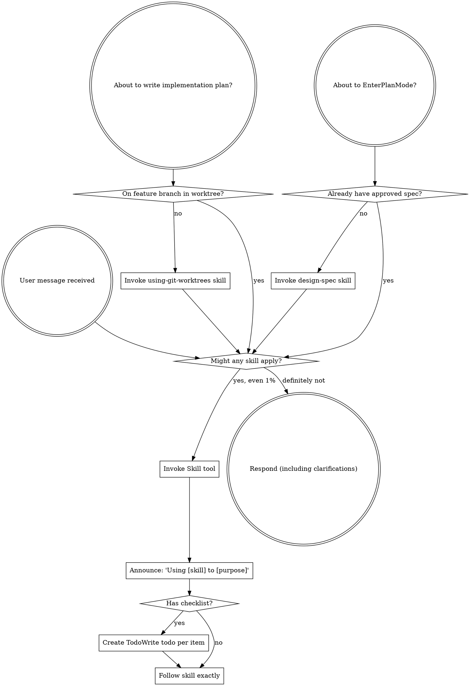

<SUBAGENT-STOP>
If you were dispatched as a subagent to execute a specific task, skip this skill.
</SUBAGENT-STOP>

<EXTREMELY-IMPORTANT>
If you think there is even a 1% chance a skill might apply to what you are doing, you ABSOLUTELY MUST invoke the skill.

IF A SKILL APPLIES TO YOUR TASK, YOU DO NOT HAVE A CHOICE. YOU MUST USE IT.

This is not negotiable. This is not optional. You cannot rationalize your way out of this.
</EXTREMELY-IMPORTANT>

## Instruction Priority

dev-tools skills override default system prompt behavior, but **user instructions always take precedence**:

1. **User's explicit instructions** (CLAUDE.md, GEMINI.md, AGENTS.md, direct requests) — highest priority
2. **dev-tools skills** — override default system behavior where they conflict
3. **Default system prompt** — lowest priority

If CLAUDE.md, GEMINI.md, or AGENTS.md says "don't use TDD" and a skill says "always use TDD," follow the user's instructions. The user is in control.

## How to Access Skills

**In Claude Code:** Use the `Skill` tool. When you invoke a skill, its content is loaded and presented to you—follow it directly. Never use the Read tool on skill files.

**In Copilot CLI:** Use the `skill` tool. Skills are auto-discovered from installed plugins. The `skill` tool works the same as Claude Code's `Skill` tool.

**In Gemini CLI:** Skills activate via the `activate_skill` tool. Gemini loads skill metadata at session start and activates the full content on demand.

**In other environments:** Check your platform's documentation for how skills are loaded.

## Platform Adaptation

Skills use Claude Code tool names. Non-CC platforms: see `references/copilot-tools.md` (Copilot CLI), `references/codex-tools.md` (Codex) for tool equivalents. Gemini CLI users get the tool mapping loaded automatically via GEMINI.md.

## Platform limitations

**Ralph loop:** Infrastructure (Stop hook + `setup-ralph-loop.sh`), **not** a workflow entry point. **`fix-bug-resolve`** uses Ralph automatically when **fix-bug** runs on Claude Code. Do **not** use `/ralph-loop` for bugs — use **fix-bug** only. `/ralph-loop` and `/cancel-ralph` are optional for **non-bug** iterative tasks on Claude Code (advanced). Cursor has session-start hook only — Ralph state at `.claude/ralph-loop.local.md` is not auto-continued on stop.

# Using Skills

## The Rule

**Invoke relevant or requested skills BEFORE any response or action.** Even a 1% chance a skill might apply means that you should invoke the skill to check. If an invoked skill turns out to be wrong for the situation, you don't need to use it.

## Red Flags

These thoughts mean STOP—you're rationalizing:

| Thought | Reality |
|---------|---------|
| "This is just a simple question" | Questions are tasks. Check for skills. |
| "I need more context first" | Skill check comes BEFORE clarifying questions. |
| "Let me explore the codebase first" | Skills tell you HOW to explore. Check first. |
| "I can check git/files quickly" | Files lack conversation context. Check for skills. |
| "Let me gather information first" | Skills tell you HOW to gather information. |
| "This doesn't need a formal skill" | If a skill exists, use it. |
| "I remember this skill" | Skills evolve. Read current version. |
| "This doesn't count as a task" | Action = task. Check for skills. |
| "The skill is overkill" | Simple things become complex. Use it. |
| "I'll just do this one thing first" | Check BEFORE doing anything. |
| "This feels productive" | Undisciplined action wastes time. Skills prevent this. |
| "I know what that means" | Knowing the concept ≠ using the skill. Invoke it. |

## Skill Priority

When multiple skills could apply, use this order:

1. **Process skills first** (design-spec, fix-bug) - these determine HOW to approach the task
2. **Planning context** (using-ai-plan) - before write-plan when repo has code
3. **Implementation skills second** (frontend-design, mcp-builder) - these guide execution

"New project" / missing `docs/product.md`, `docs/roadmap.md`, or `docs/tech-stack.md` → **plan-product** first; then **design-spec** when ready to build.
"Let's build X" → **design-spec** first (single-module spec when code exists), then write-plan (via design-spec) → **execute-plan** when ready to implement.
"Work on backlog item X" / path under `docs/agent-files/backlog/` → **add-backlog** if not documented; then **design-spec** (reads backlog detail) → write-plan → **execute-plan** when ready.
"Add to backlog" / new planned work item → **add-backlog** only.
"Add bug" / "document this bug for later" / "do not fix it now" → **add-bug** only.
"Implement the plan" / "go" / path under `docs/agent-files/plans/` → **execute-plan** only (not execute-plan-run or execute-plan-finish directly).
"Fix this bug" → **fix-bug** only. It logs/analyzes, then chooses simple direct TDD fix or complex route through **design-spec** → **execute-plan**.
"Address PR review feedback" / "review requested changes" / "fix review comments" -> **execute-plan** (review follow-up invokes **receiving-code-review** before code changes).
"Merge the PR" / "PR is approved" / "land it" -> **execute-plan** (post-review closeout invokes internal **merge-pr**).

## Skill Types

**Rigid** (TDD, debugging): Follow exactly. Don't adapt away discipline.

**Flexible** (patterns): Adapt principles to context.

The skill itself tells you which.

## User Instructions

Instructions say WHAT, not HOW. "Add X" or "Fix Y" doesn't mean skip workflows.
